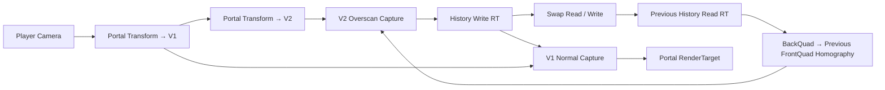
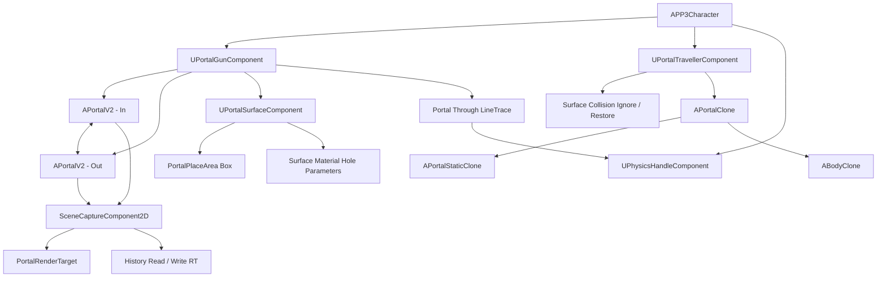

[Portal_README.md](https://github.com/user-attachments/files/31608349/Portal_README.md)
# Portal System - Unreal Engine C++ 클라이언트 포트폴리오

> Unreal Engine C++ 기반 1인칭 Portal 시스템 프로젝트입니다.  
> 포탈 배치·충돌 통과·플레이어/물리 오브젝트 텔레포트·포탈 너머 Grab을 구현하고,  
> **SceneCapture 기반 재귀 렌더링**, **History Homography Reprojection**, **Overscan**, **Ping-Pong RenderTarget**을 결합해 제한된 Capture 비용으로 깊은 재귀 화면을 구현했습니다.

## 영상

<!--


- [영상 링크](여기에 YouTube 링크)
-->

시연 영상에서는 포탈 설치, 플레이어/물리 오브젝트 통과, 포탈 너머 Grab, 재귀 렌더링과 카메라 이동·회전 시 History 안정성을 보여줍니다.

---

<a id="table-of-contents"></a>
## 목차

- [1. 프로젝트 개요](#overview)
- [2. 핵심 기술 요약](#tech-summary)
- [3. 시스템 구조](#system-architecture)
- [4. 핵심 기술 상세](#core-tech)
  - [4.1 포탈 배치 보정과 표면 검증](#portal-placement)
  - [4.2 포탈 표면 Hole 표현과 선택적 충돌 통과](#portal-surface-collision)
  - [4.3 플레이어·물리 오브젝트 텔레포트와 Clone](#portal-traveller)
  - [4.4 포탈 너머 Grab / Throw](#portal-grab)
  - [4.5 제한된 SceneCapture 기반 재귀 렌더링](#recursive-rendering)
  - [4.6 Homography 기반 History UV Reprojection](#history-reprojection)
  - [4.7 History Coverage 문제와 V2 Overscan](#history-overscan)
  - [4.8 SceneCapture 타이밍과 렌더링 최적화](#capture-optimization)
- [5. 코드 구조](#code-structure)
- [6. 최종 렌더 설정 및 검증 포인트](#render-settings)
- [7. 설계상 트레이드오프](#tradeoffs)
- [8. 한 줄 요약](#one-line-summary)

//4.3 과 4.5는 좀 덜중요한 부분이니깐 마지막쯤으로

---

<a id="overview"></a>
## 1. 프로젝트 개요

| 항목 | 내용 |
|---|---|
| 프로젝트명 | Portal System |
| 장르 | 1인칭 퍼즐 / Portal 기술 데모 |
| 엔진 | Unreal Engine C++ 4.27 |
| 개발 형태 | 개인 프로젝트 |
| 담당 영역 | 포탈 배치, 렌더링, 재귀 화면, 텔레포트, 충돌 처리, Clone, Grab 시스템 |
| 핵심 목표 | Portal게임의 Portal 기능 구현 |

### 프로젝트 방향

처음에는 두 포탈 사이의 위치·회전 변환과 SceneCapture 화면 출력부터 구현했습니다. 이후 실제 게임 플레이에 사용할 수 있도록 포탈 설치 가능 영역 검사, 벽 충돌 통과, 플레이어와 물리 오브젝트 텔레포트, Clone 기반 절단 표현, 포탈 너머 Grab을 추가했습니다.

렌더링 쪽에서는 서로 마주 보는 포탈이 논리적으로 무한히 반복되는 문제를 해결하기 위해, 현재 프레임의 실제 SceneCapture는 V1/V2 두 단계까지만 계산하고 그보다 깊은 영역은 이전 프레임의 가장 깊은 결과를 History로 재사용하는 구조를 만들었습니다.

이 과정에서 단순 History 재사용으로 인한 이전 프레임 잔상 누적, History RenderTarget Read/Write 충돌, 카메라 회전 시 History Coverage 부족, Camera Update 시점 차이 같은 문제를 순서대로 해결했습니다.

---

<a id="tech-summary"></a>
## 2. 핵심 기술 요약

| 핵심 기술 | 설명 |
|---|---|
| Portal Transform | Source Portal 좌표계를 Destination Portal 좌표계로 변환해 위치·방향·회전·속도를 유지합니다. |
| 배치 영역 보정 | Portal의 회전된 크기를 PlaceArea 축에 투영해 벽 경계를 넘지 않는 중심 위치로 Clamp합니다. |
| Surface Support Probe | 포탈 중앙·모서리·변 9지점을 LineTrace해 동일 표면과 Normal이 충분히 유지되는지 검사합니다. |
| 선택적 충돌 통과 | Traveller가 포탈 Trigger 안에 있을 때 해당 PortalSurface의 Collision Channel만 Ignore하고 기존 Response를 저장·복원합니다. |
| Traveller Clone + Clip | 포탈 양쪽에 원본/Clone을 동시에 배치하고 Material Clip Plane으로 포탈 평면을 기준으로 잘라 보이게 합니다. |
| Portal Through Grab | 첫 LineTrace가 포탈을 맞으면 Ray를 연결 포탈 좌표계로 변환해 한 번 더 Trace하고 PhysicsHandle Target도 포탈 좌표계로 변환합니다. |
| 2-Step Recursive Capture | 현재 프레임에서는 V2 Overscan Capture와 V1 Normal Capture, 총 2회의 SceneCapture만 수행합니다. |
| History Homography | 현재 `BackQuad`에서 이전 프레임 `FrontQuad`로 가는 3×3 Homography를 만들어 History Texture를 재투영합니다. |
| Ping-Pong History | `PortalRecurRenderTarget` / `PortalRecurWriteTarget`을 Read / Write로 분리하고 프레임 끝에 포인터를 Swap합니다. |
| V2 Overscan | 가장 깊은 V2를 넓은 FOV로 Capture해 현재 재귀 화면과 다음 프레임 History Coverage를 동시에 확보합니다. |
| Capture Culling | 거리, Portal 방향, 화면 가시성, 재귀 포탈 가시성에 따라 0 / 1 / 2회 Capture 경로를 선택합니다. |
| PostUpdateWork Render Tick | 플레이어 Camera 갱신 이후 별도 Tick에서 Portal Render를 수행해 한 프레임 시점 차이로 인한 화면 흔들림을 줄였습니다. |


//이부분 너무 많고 

### 핵심 렌더링 흐름



재귀 화면은 무한 SceneCapture가 아니라 **현재 프레임의 제한된 실제 재귀 + 이전 프레임 History를 이용한 깊은 재귀 근사** 구조입니다.

//이부분 좀 만 더 자세히 예를 들면 HistoryRead[Previous History Read RT] --> Reproject[BackQuad → Previous FrontQuad Homography]이부분가지고 재귀화면 쓴다는 느낌으로 잘표현되게
---

<a id="system-architecture"></a>
## 3. 시스템 구조



`UPortalGunComponent`는 설치와 Grab을 담당하고, `APortalV2`는 포탈 연결·텔레포트·SceneCapture·History를 관리합니다. `UPortalTravellerComponent`는 플레이어와 물리 오브젝트의 공통 통과 상태, 충돌 Response, 속도, Clone을 관리하도록 역할을 분리했습니다.

---

<a id="core-tech"></a>
## 4. 핵심 기술 상세

<a id="portal-placement"></a>
### 4.1 포탈 배치 보정과 표면 검증

#### 문제

LineTrace의 `ImpactPoint`에 포탈 중심을 그대로 배치하면 포탈 일부가 벽 밖으로 튀어나오거나, 서로 다른 면이 만나는 모서리·얇은 벽·장애물이 있는 위치에도 설치될 수 있습니다.

단순히 Hit 지점 하나만 검사하는 것으로는 **180 × 260cm 크기의 포탈 전체가 실제로 같은 표면 위에 올라가는지** 확인할 수 없었습니다.

#### 구현

포탈 설치는 다음 단계로 나눴습니다.

```text
Player Camera LineTrace
    ↓
PortalSurfaceComponent 확인
    ↓
Hit Normal과 PlaceArea Forward 비교
    ↓
Portal 회전 계산
    ↓
PortalInsidePlaceArea()로 중심 위치 보정
    ↓
PortalSupportCheck() 9-Point 표면 검사
    ↓
IsPortalBlock() 전방 공간 Overlap 검사
    ↓
설치 확정
```

#### PlaceArea 내부 보정

`PortalInsidePlaceArea()`는 포탈이 항상 PlaceArea와 같은 회전이라고 가정하지 않습니다.

Portal Right / Up이 PlaceArea Right / Up에 얼마나 투영되는지 계산해, 회전된 Portal이 차지하는 실제 Half Extent를 구합니다.

```text
RequiredHalfY
= |PortalRight · AreaRight| × PortalHalfWidth
+ |PortalUp · AreaRight| × PortalHalfHeight
+ EdgeMargin

RequiredHalfZ
= |PortalRight · AreaUp| × PortalHalfWidth
+ |PortalUp · AreaUp| × PortalHalfHeight
+ EdgeMargin
```

그 뒤 Hit 위치를 PlaceArea 로컬 Y/Z로 변환하고 가능한 범위로 Clamp합니다.

즉 벽 가장자리를 맞혔다고 바로 실패시키는 것이 아니라, **포탈 전체가 들어갈 수 있는 가장 가까운 유효 중심 위치로 보정**합니다.

#### 9-Point Surface Probe

보정된 중심만 유효하다고 판단하지 않고, 중앙·모서리·각 변 중앙 총 9개 지점에서 표면 뒤쪽으로 LineTrace를 수행합니다.

각 Probe는:

- 동일한 `Surface` Component를 맞혀야 함
- Hit Normal과 Portal Forward의 Dot이 `MinNormalMatch` 이상이어야 함

조건을 만족해야 설치를 허용합니다.

이 검사로 벽 모서리, 표면 단절, 다른 오브젝트 위에 일부가 걸치는 경우를 막았습니다.

#### 전방 장애물 검사

`IsPortalBlock()`은 포탈 앞쪽 깊이 영역에 Box Overlap을 수행해 Portal이 열릴 공간에 다른 Blocking Component가 있는지 확인합니다.

표면 자체와 Portal 전용 Block Box는 제외하고, 실제 Blocking Hit가 남으면 설치를 거부합니다.

<!-- 이미지 추천: 벽 가장자리 발사 → 자동 Clamp / 모서리 설치 실패 / 장애물 앞 설치 실패 3장 -->

#### 관련 코드

<details>
<summary>코드 파일 / 함수 목록 보기</summary>

```text
PP3/PortalV2/PortalGunComponent.h
PP3/PortalV2/PortalGunComponent.cpp

UPortalGunComponent::FindPortalSpot
UPortalGunComponent::CalculatePortalRotation
UPortalGunComponent::PortalInsidePlaceArea
UPortalGunComponent::PortalSupportCheck
UPortalGunComponent::IsPortalBlock
UPortalGunComponent::FirePortal
```
</details>

---

<a id="portal-surface-collision"></a>
### 4.2 포탈 표면 Hole 표현과 선택적 충돌 통과

#### 문제

포탈을 벽에 붙이는 것만으로는 플레이어가 벽 Collision에 막혀 실제로 통과할 수 없습니다.

반대로 벽 Collision 전체를 꺼버리면 Portal Aperture 바깥에서도 벽을 통과할 수 있고, 다른 Actor에도 영향을 줄 수 있습니다.

#### 구현 방향

이 프로젝트에서는 Runtime Mesh Boolean으로 실제 벽 Collision에 구멍을 뚫지 않고, **시각적 Hole과 Traveller의 물리 Collision 처리를 분리**했습니다.

##### 시각적 Hole

`UPortalSurfaceComponent`는 In / Out Portal 두 개의 Hole 정보를 별도로 관리합니다.

각 Hole은:

```text
Center
Forward
Right
Up
HalfWidth / HalfHeight / HalfDepth
Enabled
```

값을 Surface의 Dynamic Material Instance에 전달합니다.

따라서 같은 표면에 In / Out Portal 상태를 각각 켜고 끌 수 있습니다.

##### 물리 Collision 통과

`UPortalTravellerComponent`가 Portal Trigger에 들어오면 현재 PortalSurface의 Collision Object Channel을 수집하고, Traveller를 구성하는 Primitive Component들의 기존 Response를 저장한 뒤 해당 Channel만 `Ignore`로 변경합니다.

```text
Portal Trigger 진입
    ↓
현재 Surface Collision Channel 확인
    ↓
Primitive별 기존 Response 저장
    ↓
해당 Channel만 Ignore
    ↓
Portal 통과
    ↓
Trigger 종료 후 기존 Response 복원
```

초기에는 단순히 Ignore → Block으로 되돌리는 방식도 검토했지만, 원래 Response가 Block이 아닐 수 있기 때문에 최종 코드에서는 `FSavedPortalCollision`에 Primitive / Channel / 기존 Response를 저장해 정확히 복구하도록 보완했습니다.

또 Portal Actor 둘레에는 여러 개의 `PortalBlock` Box를 두어 Traveller가 Surface Channel을 Ignore하는 동안에도 Aperture 바깥쪽으로 빠져나가는 것을 제한합니다.

#### 트레이드오프

이 방식은 실제 Collision Mesh에 동적으로 구멍을 생성하는 방식보다 구현과 갱신 비용이 단순합니다. 대신 **Portal Trigger 안에서 특정 Surface Channel을 일시적으로 무시하는 방식**이므로, 표면 Collision Channel 설계와 Portal Block 영역을 함께 관리해야 합니다.

<!-- 이미지 추천: Portal Surface Material Hole + Collision Debug Box -->

#### 관련 코드

<details>
<summary>코드 파일 / 함수 목록 보기</summary>

```text
PP3/PortalV2/PortalSurfaceComponent.h
PP3/PortalV2/PortalSurfaceComponent.cpp
PP3/PortalV2/PortalTravellerComponent.h
PP3/PortalV2/PortalTravellerComponent.cpp
PP3/PortalV2/PortalV2.cpp

UPortalSurfaceComponent::SetPortalHole
UPortalSurfaceComponent::ClearPortalHole
UPortalSurfaceComponent::UpdatePortalMaterial
UPortalTravellerComponent::EnterPortal
UPortalTravellerComponent::UpdatePortalCollisionResponse
UPortalTravellerComponent::RestorePortalCollisionResponse
APortalV2::AddSurfaceHole
APortalV2::AllPortalBlocksBlockOn
```
</details>

---

<a id="portal-traveller"></a>
### 4.3 플레이어·물리 오브젝트 텔레포트와 Clone

#### Portal Transform

포탈 통과 시 Source Portal의 Forward / Right / Up 축을 기준으로 입력 Vector를 로컬 성분으로 분해한 뒤, Destination Portal의 반대 방향 축으로 다시 조합합니다.

```text
World Vector
    ↓
Source Portal Local Coordinate
    ↓
Destination Portal Basis + 180° 방향 전환
    ↓
Transformed Vector
```

같은 변환 규칙을 위치, 방향, 회전, 속도에 공통으로 사용합니다.

#### 통과 판정

Traveller는 이전 프레임 위치 `PreLocation`과 현재 위치를 저장합니다.

Portal Plane의 앞쪽에서 뒤쪽으로 넘어갔는지 Dot Product로 검사하고, 선분과 Portal Plane이 만나는 `CrossingPoint`가 실제 Aperture 내부인지 한 번 더 확인한 뒤 텔레포트합니다.

```text
PreviousSide > 0
CurrentSide <= 0
    ↓
Portal Plane Crossing Point 계산
    ↓
Portal HalfSize 내부인지 확인
    ↓
Teleport
```

단순 Trigger 진입만으로 이동시키지 않기 때문에 Portal 앞에서 옆으로 스쳐 지나가는 경우를 줄였습니다.

#### 플레이어

플레이어는:

- 위치
- Controller Control Rotation
- Character Yaw
- CharacterMovement Velocity

를 연결 Portal 기준으로 변환합니다.

출구에서는 변환된 속도 방향으로 `ExitOffset`을 적용해 출구 평면에 다시 걸리는 현상을 줄였습니다.

#### 물리 오브젝트

`PortalObject` Tag가 붙은 Primitive를 Teleport 기준 Component로 사용합니다.

물리 오브젝트는:

- Component Location / Rotation
- Linear Velocity
- Angular Velocity

를 모두 Portal Transform한 뒤 `TeleportPhysics`로 이동하고 속도를 다시 적용합니다.

#### Clone + Plane Clip

오브젝트가 Portal을 절반만 통과한 순간에는 원본 하나만 이동시키면 한쪽 Portal에서 갑자기 사라지는 문제가 생깁니다.

이를 위해 Traveller가 Portal Trigger에 들어오면 반대편에 Clone을 생성하고 Portal Transform으로 위치를 동기화합니다.

원본과 Clone Material에는 `ClipPoint`, `ClipNormal`, `ClipOn`을 전달해 Portal Plane을 기준으로 서로 반대쪽 부분만 보이도록 처리했습니다.

- `APortalStaticClone`: Static Mesh 기반 물리 오브젝트 Clone
- `ABodyClone`: Player Skeletal Mesh 기반 Clone

<!-- 이미지 추천: 큐브가 절반 통과한 장면 / 플레이어 Body Clone 장면 -->

#### 관련 코드

<details>
<summary>코드 파일 / 함수 목록 보기</summary>

```text
PP3/PortalV2/PortalV2.h
PP3/PortalV2/PortalV2.cpp
PP3/PortalV2/PortalTravellerComponent.h
PP3/PortalV2/PortalTravellerComponent.cpp
PP3/PortalV2/PortalClone.h
PP3/PortalV2/PortalClone.cpp
PP3/PortalV2/PortalStaticClone.h
PP3/PortalV2/PortalStaticClone.cpp
PP3/Character/BodyClone.h
PP3/Character/BodyClone.cpp

APortalV2::TransformPoint
APortalV2::TransformVector
APortalV2::TransformRotation
APortalV2::FindCrossPoint
APortalV2::TeleportPlayer
APortalV2::TeleportObjects
UPortalTravellerComponent::GetPhysicsData
UPortalTravellerComponent::SetPhysicsData
UPortalTravellerComponent::ShowClone
UPortalTravellerComponent::SetOriginalClip
```
</details>

---

<a id="portal-grab"></a>
### 4.4 포탈 너머 Grab / Throw

#### 문제

일반 PhysicsHandle Grab은 Player Camera에서 대상까지 한 공간 안에서만 LineTrace하면 됩니다.

하지만 포탈 너머의 물체를 잡으려면:

```text
Player Ray
→ Portal Hit
→ 연결 Portal에서 Ray 계속 진행
→ Object Hit
```

처럼 Ray와 Grab Target 모두 Portal Transform을 거쳐야 합니다.

#### 구현

`FindGrabHit()`에서 첫 Trace가 일반 물체를 맞히면 그대로 사용하고, 활성화된 Portal Plane을 맞힌 경우 남은 Trace 거리를 계산합니다.

그 뒤:

- Hit Point를 연결 Portal 위치로 `TransformPoint`
- View Direction을 `TransformVector`
- 연결 Portal 쪽에서 남은 거리만큼 두 번째 LineTrace

를 수행합니다.

현재 구현은 **한 번의 Portal 통과 Trace**를 지원합니다.

#### PhysicsHandle Target 변환

포탈 너머 물체를 잡은 상태에서는 Player의 `GrabSocket` 위치를 그대로 Target으로 사용하지 않고, `GrabPortal->TransformPoint(TargetLocation)`으로 반대 공간에 변환합니다.

Player 또는 Grabbed Object 자체가 Portal을 통과하면 `OnPortalTeleport` Delegate로 현재 Grab 관계를 다시 계산하고 PhysicsHandle을 재연결합니다.

던지기 방향 역시 Portal 너머에서 잡고 있다면 `TransformVector`를 적용합니다.

<!-- 이미지 추천: 포탈 너머 큐브 Grab → Player 이동 → 큐브 통과 → Throw -->

#### 관련 코드

<details>
<summary>코드 파일 / 함수 목록 보기</summary>

```text
PP3/PortalV2/PortalGunComponent.h
PP3/PortalV2/PortalGunComponent.cpp

UPortalGunComponent::FindGrabHit
UPortalGunComponent::GrabObject
UPortalGunComponent::GrabUpdate
UPortalGunComponent::OnPlayerTeleport
UPortalGunComponent::OnGrabObjectTeleport
UPortalGunComponent::ResetGrabAfterTeleport
UPortalGunComponent::GrabLaunch
```
</details>

---

<a id="recursive-rendering"></a>
### 4.5 제한된 SceneCapture 기반 재귀 렌더링

#### 문제

서로 마주 보는 두 포탈은 논리적으로 다음처럼 끝없이 이어집니다.

```text
V1
└─ V2
   └─ V3
      └─ V4
         └─ ...
```

하지만 각 단계마다 SceneCapture를 추가하면 재귀 깊이에 비례해 렌더링 비용이 증가합니다.

#### 최종 구조

최종 `PortalV2` 코드는 `RecursionCount` 배열을 순회하는 구조가 아니라, 현재 프레임에서 사용할 V1 / V2 View를 직접 계산하는 **고정 2단계 재귀 구조**입니다.

```text
PlayerView
    ↓ Portal Transform 1회
V1
    ↓ Portal Transform 1회
V2
```

재귀 화면이 필요한 프레임에는:

```text
1. V2 Overscan → PortalRecurWriteTarget Capture
2. V1 Normal   → PortalRenderTarget Capture
```

총 2번의 `CaptureScene()`만 수행합니다.

V2보다 깊은 영역은 이전 프레임 History를 재투영해서 사용합니다.

#### 첫 프레임과 이후 프레임

History가 없을 때는 가장 깊은 Portal 영역에서 `RecurFallbackColor`를 사용합니다.

```text
Frame 1
V1
└─ V2
   └─ Fallback
```

History가 쌓인 이후에는 이전 프레임의 가장 깊은 결과 안에 이미 더 이전 History가 포함되어 있기 때문에 화면상으로 더 깊은 재귀가 이어집니다.

```text
Frame 2
V1
└─ V2
   └─ Frame 1 History

Frame 3
V1
└─ V2
   └─ Frame 2 History
      └─ Frame 1 History
```

따라서 이 프로젝트의 재귀는 **완전한 무한 재귀 렌더링이 아니라, 제한된 실제 재귀 + Temporal History를 이용한 무한 재귀 근사**입니다.

#### SceneCapture Clip Plane

Portal Camera는 `bEnableClipPlane`을 사용하고 연결 Portal의 위치와 Forward를 Clip Plane으로 설정합니다.

이를 통해 연결 Portal 뒤쪽의 불필요한 Geometry가 Portal 화면에 섞이지 않도록 잘라냅니다.

#### 관련 코드

<details>
<summary>코드 파일 / 함수 목록 보기</summary>

```text
PP3/PortalV2/PortalV2.h
PP3/PortalV2/PortalV2.cpp

APortalV2::CaptureNormal
APortalV2::CaptureRecursive
APortalV2::SetCameraProjection
APortalV2::MakeCaptureView
APortalV2::SetRecursionMaterial
APortalV2::RestorePortalRenderState
```
</details>

---

<a id="history-reprojection"></a>
### 4.6 Homography 기반 History UV Reprojection

#### 처음 발생한 문제: Temporal Feedback

초기에는 이전 `PortalRenderTarget` 또는 재귀용 RenderTarget을 다음 프레임의 가장 깊은 Portal Texture로 그대로 재사용하는 방식으로 접근했습니다.

카메라가 정지해 있을 때는 그럴듯했지만 이동하면:

```text
현재 화면
└─ 이전 프레임 화면
   └─ 더 이전 프레임 화면
      └─ ...
```

처럼 과거 화면이 안쪽에 남아 Ghosting과 화면 누적이 발생했습니다.

History를 사용하더라도 **현재 프레임에서 Portal이 차지하는 화면 위치와 이전 History 안의 Portal 위치를 맞춰서 다시 샘플링**해야 했습니다.

#### Quad 계산

V1과 V2 각각에서 Portal 네 꼭짓점을 ViewProjection Matrix로 Screen UV에 투영합니다.

최종 코드 기준으로 History에 사용하는 Quad는:

```text
CurrentHistoryFrontQuad = V1에서 계산한 Portal Screen Quad
CurrentHistoryBackQuad  = V2에서 계산한 Portal Screen Quad
```

입니다.

현재 프레임의 가장 깊은 Portal 영역인 `CurrentHistoryBackQuad`를 이전 프레임에 저장해 둔 `PortalHistory.FrontQuad`로 재투영합니다.

#### 3×3 Homography

최종 구현은 Inverse Bilinear 수식을 직접 푸는 방식이 아니라, **Unit Square ↔ Screen Quad 사이의 Projective Homography**를 구성합니다.

```text
CurrentMatrix : Unit Square → Current BackQuad
HistoryMatrix : Unit Square → Previous FrontQuad
```

현재 Screen UV를 Unit Square 좌표로 되돌린 뒤 같은 좌표를 이전 History Quad로 보내기 위해:

```text
HistoryHomography
= HistoryMatrix × inverse(CurrentMatrix)
```

를 계산합니다.

```text
Current BackQuad ScreenUV
    ↓ inverse(CurrentMatrix)
Unit Square Coordinate
    ↓ HistoryMatrix
Previous FrontQuad SampleUV
```

계산한 3×3 행렬은 `History0`, `History1`, `History2` Material Parameter로 전달합니다.

#### Quad 유효성 검사

투영 결과에 대해:

- `W > KINDA_SMALL_NUMBER`
- 유한값 여부
- 최소 Width / Height
- Shoelace 방식의 Quad Area

를 확인합니다.

Quad가 순간적으로 유효하지 않을 때는 바로 기존 History를 파기하지 않고 `HistoryInvalidGraceFrames = 1`만큼 한 프레임 유예한 뒤 계속 실패하면 History를 무효화합니다.

#### 표현 범위

이 방식은 Depth Buffer, Motion Vector, Per-Pixel World Position을 사용하는 일반적인 3D Temporal Reprojection과 다릅니다.

포트폴리오에서는 다음처럼 표현하는 것이 정확합니다.

```text
X 완전한 3D Temporal Reprojection
O Portal Screen Quad 기반 Homography History Reprojection
```

<!-- 이미지 추천: Current BackQuad / Previous FrontQuad를 겹쳐 표시한 디버그 이미지 -->

#### 관련 코드

<details>
<summary>코드 파일 / 함수 목록 보기</summary>

```text
PP3/PortalV2/PortalV2.h
PP3/PortalV2/PortalV2.cpp

APortalV2::CalculatePortalClipQuad
APortalV2::IsClipQuadValid
APortalV2::MakeSquareQuad
APortalV2::InverseHomography
APortalV2::MultiplyHomography
APortalV2::MakePortalHomography
APortalV2::SetHistoryHomography
APortalV2::SetHistoryMaterial
```
</details>

---

<a id="history-overscan"></a>
### 4.7 History Coverage 문제와 V2 Overscan

#### 문제

Homography를 적용한 뒤에도 카메라를 회전하면 다음 프레임에서 필요해지는 History Sample 영역이 이전 프레임 Texture 바깥으로 나가는 문제가 남았습니다.

테스트 과정에서는 필요한 UV가 대략:

```text
-0.05
1.05
```

정도까지 0~1 범위를 벗어나는 상황을 확인했습니다.

문제의 핵심은 Reprojection 계산 자체보다 **이전 프레임에 필요한 주변 화면이 애초에 저장되어 있지 않다는 Coverage 부족**이었습니다.

#### 첫 시도: Canonical Rotation

처음에는 Player Camera 회전과 History Camera 회전을 분리해 History 좌표계를 고정하려 했습니다.

예를 들어 V2 위치는 유지하고 Camera가 Portal Center를 바라보도록 Rotation을 다시 만드는 방식을 실험했습니다.

| 방식 | 기대 | 실제 문제 | 판단 |
|---|---|---|---|
| Player-aligned Rotation | 현재 화면과 ScreenUV 대응이 자연스러움 | 회전 시 History Coverage가 부족할 수 있음 | 기본 구조 유지 |
| Canonical Rotation | History 좌표계를 안정화할 수 있음 | Player ScreenUV와 Capture UV 불일치, 근접/비스듬한 위치에서 Forward 기준 불안정 | 폐기 |
| Off-Axis Projection 확장 | Portal Aperture에 맞는 정확한 Frustum 구성 가능 | History 문제 하나를 해결하기에는 구현 복잡도가 크게 증가 | 미채택 |
| V2 Overscan | 기존 좌표계 유지 + 주변 영역 선확보 | 같은 RT 안에서 유효 해상도 일부 감소 | 최종 채택 |

Canonical Camera를 사용하면 기존 `ScreenAlignedUV → Portal RenderTarget` 대응이 깨져 일반 Portal 화면까지 별도 Reprojection이 필요했습니다.

또 Camera가 Portal에 가까워질수록 `Camera → PortalCenter` 방향이 작은 위치 변화에도 크게 흔들려, 오히려 안정성이 떨어질 수 있었습니다.

그래서 Camera Rotation을 바꾸는 방식은 폐기했습니다.

#### 최종 해결: V2 자체를 Overscan

Player-aligned Camera는 그대로 유지하고, 가장 깊은 실제 Capture인 V2의 FOV만 넓혔습니다.

최종 설정은:

```text
HistoryOverscanScale = 1.15
```

입니다.

FOV는 단순히 각도에 1.15를 곱하지 않고, 화면 중심 기준 Tan Half-FOV에 Scale을 적용해 계산합니다.

```text
OverscanFOV
= 2 × atan(tan(BaseFOV / 2) × OverscanScale)
```

이렇게 V2에서 현재 화면 밖 주변 영역까지 같이 저장해 다음 프레임 Reprojection이 사용할 여유 공간을 확보했습니다.

#### V1에서 V2 Overscan을 읽을 때 보정

V1은 Normal FOV인데 입력 Texture인 V2만 Wider FOV이므로 그대로 같은 UV를 사용하면 재귀 화면이 축소되어 보입니다.

구현 과정에서는 중앙 기준으로 다음과 같이 UV를 보정했습니다.

```text
OverscanUV
= 0.5 + (ScreenUV - 0.5) / OverscanScale
```

C++에서는 `DeepOverscanScale`, `UseDeepOverscanMapping` Parameter를 Portal Material에 전달하고, V1이 V2 Overscan Texture를 읽는 순간에만 Mapping을 활성화합니다.

#### History 전용 Capture 제거

초기 Overscan 구조에서는:

```text
V2 Normal Capture
V1 Normal Capture
History Overscan Capture
```

총 3회의 SceneCapture가 필요했습니다.

최종 구조는 V2 자체를 Overscan으로 바꿔 한 장을 두 용도로 재사용합니다.

```text
V2 Overscan Capture
├─ 현재 프레임 V1 내부 재귀 화면의 입력
└─ 다음 프레임 History

V1 Normal Capture
└─ 최종 PortalRenderTarget
```

그 결과 재귀 프레임의 `CaptureScene()` 호출을 **3회 → 2회**로 줄였습니다.

#### History Copy 제거와 Ping-Pong

중간 구현에서는 가장 깊은 결과를 별도 History WriteTarget으로 GPU Copy한 뒤 Read / Write를 Swap하는 구조를 사용했습니다.

최종 코드에서는 V2가 처음부터 `PortalRecurWriteTarget`에 직접 Capture되므로 별도 `CopyRenderTarget()`이 필요하지 않습니다.

프레임 끝에:

```cpp
Swap(PortalRecurRenderTarget, PortalRecurWriteTarget);
```

으로 포인터 역할만 바꿉니다.

따라서 최종 History 경로는:

```text
Previous Frame
PortalRecurRenderTarget = Read

Current Frame
V2 Overscan → PortalRecurWriteTarget = Write
V1 samples PortalRecurWriteTarget

Frame End
Swap(Read, Write)

Next Frame
이전 Write 결과가 새로운 History Read
```

가 됩니다.

이 구조로 같은 RenderTarget을 동시에 Read/Write하는 피드백 위험을 피하면서 별도 Texture Copy도 제거했습니다.

<!-- 이미지 추천: 3 Capture 구조와 최종 2 Capture 구조 비교 다이어그램 -->

#### 관련 코드

<details>
<summary>코드 파일 / 함수 목록 보기</summary>

```text
PP3/PortalV2/PortalV2.h
PP3/PortalV2/PortalV2.cpp

APortalV2::MakeCaptureView
APortalV2::CaptureRecursive
APortalV2::SetDeepOverscanMapping
APortalV2::SavePortalHistory
APortalV2::InvalidatePortalHistory
```
</details>

---

<a id="capture-optimization"></a>
### 4.8 SceneCapture 타이밍과 렌더링 최적화

#### 문제 1: Camera Update 시점 차이

Portal Camera는 Player Camera와 같은 프레임의 시점을 기준으로 계산되어야 합니다.

개발 과정에서 Portal Render를 일반 Actor Tick 시점에 수행했을 때 Player Camera 갱신과 SceneCapture 갱신 시점이 어긋나, 빠른 회전이나 텔레포트 직후 Portal 화면이 한 프레임 늦게 따라오는 것처럼 보이는 문제가 있었습니다.

#### 해결: Render 전용 Tick 분리

일반 `APortalV2::Tick()`은 Traveller 통과 판정과 Clone 업데이트에 사용하고, Portal Render만 별도의 `FPortalRenderTickFunction`으로 분리했습니다.

```text
APortalV2::Tick
→ Traveller / Crossing / Clone

FPortalRenderTickFunction
TickGroup = TG_PostUpdateWork
→ UpdatePortalRender
```

최종 코드는 `TG_PostUpdateWork`에서 `CameraManager->GetCameraCachePOV()`를 읽어 Portal SceneCapture를 갱신합니다.

이렇게 Player Camera Update 이후에 Portal Capture를 수행해 시점 불일치로 인한 흔들림을 줄였습니다.

#### 문제 2: 보이지 않는 Portal도 매 프레임 Capture

SceneCapture는 Portal 시스템에서 가장 큰 렌더링 비용이므로, 활성 상태만 보고 무조건 Capture하지 않도록 조건을 나눴습니다.

`ShouldCapture()`는 다음을 확인합니다.

```text
1. 두 Portal이 모두 Active인가?
2. MaxCaptureDistance 안인가?
3. CloseCaptureDistance 이내인가? → 가까우면 바로 Capture
4. Player가 Portal 앞면에 있는가?
5. Portal 네 꼭짓점이 View Frustum에 보이는가?
```

`IsPortalVisibleView()`는 Portal 네 꼭짓점을 Clip Space로 직접 투영합니다.

- 네 점 모두 Camera 뒤면 → 보이지 않음
- 일부 점만 Camera 앞면 → 경계 상황이므로 보이는 것으로 처리
- 네 점 모두 앞면 → NDC -1~1 범위를 기준으로 화면 바깥 한쪽에 완전히 벗어났는지 검사

#### 재귀가 필요한 경우만 2회 Capture

외부 Portal 자체가 보이더라도 그 안에서 다음 Portal이 보이지 않으면 재귀 Capture가 필요하지 않습니다.

`IsRecursivePortalVisible()`로 V1 시점에서 다음 Portal 가시성을 검사해:

| 상태 | Capture 경로 | `CaptureScene()` 횟수 |
|---|---|---:|
| Portal 비활성 / 너무 멀음 / 화면 밖 | Capture 안 함 | 0 |
| Portal은 보이지만 재귀 Portal은 안 보임 | Normal Capture | 1 |
| 재귀 Portal도 보임 | V2 Overscan + V1 Normal | 2 |

으로 나눴습니다.

#### 재귀 RenderTarget 해상도 분리

최종 Portal 화면은 현재 Viewport 크기로 `PortalRenderTarget`을 생성하고, 재귀용 Read / Write RenderTarget은:

```text
RecursiveRenderScale = 0.75
```

를 적용합니다.

즉 가장 눈에 잘 보이는 최종 V1 화면은 Full Resolution을 유지하고, 안쪽에 반복되는 V2 / History만 낮은 해상도로 처리합니다.

#### 재귀 단계 ShowFlag 축소

V2 Capture에서는 다음 후처리/고비용 항목을 비활성화합니다.

```text
Depth of Field
Lens Flares
Grain
Vignette
Camera Imperfections
Scene Color Fringe
Screen Space Reflections
```

V2 Capture가 끝나면 기존 ShowFlags를 다시 복원합니다.

#### 최적화 방향

이 프로젝트에서는 LOD / `MaxViewDistanceOverride`처럼 시연 맵의 Asset 규모에 따라 효과가 달라지는 최적화보다, **Portal 시스템 자체에서 직접 비용이 발생하는 SceneCapture 횟수·가시성·재귀 해상도·ShowFlag를 우선적으로 줄이는 방향**을 선택했습니다.

#### 관련 코드

<details>
<summary>코드 파일 / 함수 목록 보기</summary>

```text
PP3/PortalV2/PortalV2.h
PP3/PortalV2/PortalV2.cpp

FPortalRenderTickFunction::ExecuteTick
APortalV2::RegisterActorTickFunctions
APortalV2::ShouldCapture
APortalV2::IsPortalVisibleView
APortalV2::IsPortalVisible
APortalV2::IsRecursivePortalVisible
APortalV2::ApplyRecursiveShowFlags
APortalV2::UpdatePortalRender
```
</details>

---

<a id="code-structure"></a>
## 5. 코드 구조

```text
PP3/
├── Character/
│   ├── PP3Character.h/.cpp          # 1인칭 Player, Portal / Grab 입력
│   └── BodyClone.h/.cpp             # Player Skeletal Mesh Portal Clone
│
├── PortalV2/                        # 최종 포트폴리오 Portal 시스템
│   ├── PortalV2.h/.cpp              # Portal Transform, Teleport, SceneCapture, Recursion, History
│   ├── PortalGunComponent.h/.cpp    # Portal 배치 검사, 발사, Portal Through Grab
│   ├── PortalTravellerComponent.*   # 통과 상태, Collision, Physics, Clone
│   ├── PortalSurfaceComponent.*     # 설치 가능 영역, Surface Hole Material Data
│   ├── PortalClone.*                # Clone 공통 Transform / Clip
│   ├── PortalStaticClone.*          # Static Mesh Traveller Clone
│   └── PortalPlacementAreaComponent.*
│
├── Obj/
│   ├── Grab_Obj.*                   # PortalTraveller가 적용된 Physics Object
│   ├── ButtonDoor_Obj.*
│   ├── ButtonLaser_Obj.*
│   ├── Door_Obj.*
│   ├── LaserWall_Obj.*
│   └── Wire_Obj.*
│
├── Portal/                          # 이전 Portal Prototype / Legacy 코드
└── Widget/                          # HUD / Gun Mode / Crosshair
```

이 README의 핵심 구현 설명은 `PortalV2/` 기준입니다. `Portal/` 폴더는 이전 Prototype 코드가 남아 있는 Legacy 영역으로, 최종 재귀/History 구조 설명에는 사용하지 않았습니다.

---

<a id="render-settings"></a>
## 6. 최종 렌더 설정 및 검증 포인트

### 최종 코드 설정

| 항목 | 값 | 역할 |
|---|---:|---|
| Portal Half Size | 90 × 130cm | 실제 Portal 크기 180 × 260cm |
| Main RenderTarget | 현재 Viewport Size | 최종 V1 화면 |
| Main RT Format | `RTF_RGBA16f` | Portal 최종 HDR RenderTarget |
| Recursive RT Scale | `0.75` | V2 / History Read·Write 해상도 축소 |
| History Overscan Scale | `1.15` | 다음 프레임 History Coverage 확보 |
| Max Capture Distance | 8000cm | 이 거리 밖에서는 Capture 중단 |
| Close Capture Distance | 200cm | 근접 시 화면 경계 판정보다 Capture 안정성을 우선 |
| History Invalid Grace | 1 Frame | 순간적인 Quad Invalid로 History가 즉시 끊기는 현상 완화 |
| Normal Capture | 1회 | V1만 Capture |
| Recursive Capture | 2회 | V2 Overscan + V1 Normal |

### 최종적으로 확인한 동작

```text
Portal 설치 가능 영역 보정
Portal 앞 장애물 / 표면 단절 설치 거부
Player Portal 통과 + Control Rotation / Velocity 유지
Physics Object 위치·회전·선형/각속도 변환
Traveller Clone + Portal Plane Clip
Portal 너머 PhysicsHandle Grab / Throw
SceneCapture Clip Plane
V1 / V2 재귀 화면
History Homography Reprojection
History Read / Write Ping-Pong
V2 Overscan Coverage
PostUpdateWork Camera Timing
거리 / 방향 / 화면 가시성 기반 Capture Culling
재귀 단계 0.75 Resolution + ShowFlag 축소
```

### History가 없거나 유효하지 않을 때

첫 재귀 프레임처럼 History가 아직 없으면 `UseHistory = 0`으로 두고 `RecurFallbackColor`를 사용합니다.

현재 Quad 계산이 실패한 경우에도 History Texture를 잘못 샘플링하지 않고 History 사용을 끄며, 한 프레임 Grace 이후에도 계속 유효하지 않으면 History State를 Reset합니다.

Portal 재배치, 링크 변경, 비활성화, 텔레포트처럼 기존 History와 현재 Camera 관계가 크게 바뀌는 이벤트에서도 History를 무효화해 이전 공간의 화면이 남지 않도록 처리했습니다.

---

<a id="tradeoffs"></a>
## 7. 설계상 트레이드오프

### 제한된 실제 재귀 + History 근사

현재 프레임의 실제 SceneCapture를 V1 / V2 두 단계로 제한했기 때문에 Capture 비용을 통제할 수 있습니다.

대신 V3 이후는 이전 프레임 결과를 사용하므로 빠른 Camera 이동·회전에서는 완전한 현재 프레임 재귀와 미세한 Temporal 차이가 생길 수 있습니다.

이 프로젝트에서는 무한 재귀를 정확히 렌더링하는 것보다 **고정된 Capture 비용 안에서 깊은 재귀가 이어지는 시각적 결과**를 우선했습니다.

### Portal Quad 기반 Reprojection

History Reprojection은 Portal Plane의 네 꼭짓점만 사용합니다.

따라서 Portal 영역 자체의 화면상 위치 변화는 보정할 수 있지만, History Texture 내부의 모든 3D Geometry를 Depth / Motion Vector 기준으로 재투영하는 구조는 아닙니다.

장점은 구현 복잡도와 필요한 Buffer를 크게 늘리지 않고 Portal이라는 제한된 문제에 맞춰 적용할 수 있다는 점입니다.

### Overscan과 유효 해상도

`HistoryOverscanScale = 1.15`로 주변 영역을 더 저장해 Camera 회전에 대한 Coverage를 확보했습니다.

대신 같은 RenderTarget 해상도 안에서 더 넓은 FOV를 담기 때문에 History 중심부가 사용하는 실질적인 픽셀 밀도는 낮아집니다.

이를 보완하기 위해 최종 Portal 화면은 Full Resolution을 유지하고, 안쪽 재귀 화면만 `RecursiveRenderScale = 0.75`로 별도 관리했습니다.

### 선택적 Collision Ignore 방식

Runtime Collision Mesh에 실제 구멍을 만드는 대신, Portal 내부 Traveller만 해당 Surface Channel을 Ignore하도록 만들었습니다.

구조가 단순하고 Surface를 재생성할 필요가 없지만, Portal 가능한 벽은 Collision Channel과 PortalBlock 규칙을 맞춰야 합니다.

### 고정된 직사각형 Portal 범위

현재 배치 검사와 Screen Quad 계산은 `PortalHalfSize`를 기준으로 한 직사각형 Aperture를 전제로 합니다.

시각적으로 타원형 Mask를 적용하는 것은 가능하지만, 실제 타원형 경계를 기준으로 배치·통과 판정을 정확하게 만들려면 Aperture 내부 판정과 Surface 지원 검사를 별도로 확장해야 합니다.

### Portal Through Grab의 재귀 깊이

Grab Trace는 Portal을 한 번 통과한 뒤 두 번째 Trace를 수행합니다.

여러 Portal을 연속해서 통과하는 일반화된 Ray Traversal 구조는 아니지만, 현재 게임 플레이 범위에서는 한 쌍의 연결 Portal 너머 상호작용에 필요한 기능을 우선 구현했습니다.

---

<a id="one-line-summary"></a>
## 8. 한 줄 요약

> Portal 배치·Collision·Traveller·Grab 시스템을 구현하고, **2회의 SceneCapture + Homography History Reprojection + V2 Overscan + Ping-Pong RenderTarget**으로 깊은 재귀 화면을 제한된 렌더링 비용 안에서 근사한 Unreal Engine C++ 클라이언트 포트폴리오입니다.
