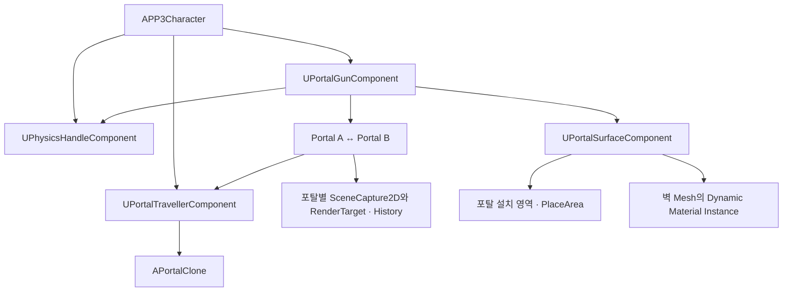

# Portal System - Unreal Engine C++ 클라이언트 포트폴리오

> Unreal Engine C++ 기반 1인칭 Portal 시스템 프로젝트입니다.  
> 재귀가 필요한 포탈은 두 단계까지 새로 Capture하고, 더 깊은 부분은 **이전 프레임에 저장한 안쪽 화면(History)의 위치를 보정해 재사용**했습니다. 플레이어·물리 오브젝트의 통과와 포탈 너머 물체 Grab·Throw도 같은 좌표 변환을 기준으로 구현했습니다.

---

## 시연 영상

<a href="https://youtu.be/VeI2WFhfKv0">
  
</a>

▶ [전체 시연 영상](https://youtu.be/VeI2WFhfKv0)

---

<a id="table-of-contents"></a>

## 목차

- [1. 프로젝트 개요](#overview)
- [2. 핵심 기술 요약](#tech-summary)
- [3. 시스템 구조](#system-architecture)
- [4. 핵심 기술 상세](#core-tech)
  - [4.1 재귀 렌더링 - 2회 Capture와 History](#recursive-rendering)
  - [4.2 포탈 근접 렌더링 - 평면 잘림과 벽 노출 해결](#portal-nearclip)
  - [4.3 SceneCapture 최적화와 갱신 순서](#capture-optimization)
  - [4.4 텔레포트와 Clone](#portal-teleport-clone)
  - [4.5 포탈 배치 - 설치 영역과 9곳의 표면 검사](#portal-placement)
  - [4.6 포탈 통과 시 충돌 처리](#portal-surface-collision)
  - [4.7 포탈 너머 Grab / Throw](#portal-grab)
- [5. 코드 구조](#code-structure)
- [6. 공통 측정 환경](#measurement-method)
- [7. 설계상 트레이드오프](#tradeoffs)

---

<a id="overview"></a>

## 1. 프로젝트 개요

| 항목    | 내용                                          |
| ----- | ------------------------------------------- |
| 프로젝트명 | Portal System                               |
| 장르    | 1인칭 퍼즐 / Portal 기술 데모                       |
| 엔진 / 언어 | Unreal Engine 4.27 / C++                    |
| 담당 영역 | 포탈 배치, 렌더링, 재귀 화면, 충돌 처리, 텔레포트, Clone, Grab |
| 핵심 목표 | 두 포탈 사이의 렌더링·이동·물리 상호작용을 연결하고, 재귀 렌더링까지 구현한 Portal 시스템     |
| 개발 인원 | 1명                                          |
| 개발 기간 | 3~4개월                                       |


### 프로젝트 방향

두 포탈 사이로 화면과 플레이어, 물리 오브젝트가 이어지도록 만드는 데 초점을 맞췄습니다. 

근접 시 화면이 잘리는 문제, 입구 주변의 충돌, 재귀 화면의 잔상과 Capture 비용을 각각 확인하고 개선했습니다.

---

<a id="tech-summary"></a>

## 2. 핵심 기술 요약

| 핵심 기술 | 설명 |
|---|---|
| 재귀 렌더링 | 재귀가 필요한 포탈 하나당 한 프레임에 2회 Capture하고, 더 깊은 부분은 Homography로 History의 위치를 보정해 사용했습니다. |
| 근접 렌더링 | 가까이 가거나 통과할 때 화면이 잘리는 문제를 입구가 열린 상자형 보조 Mesh로 보완했습니다. 틈으로 드러나는 벽은 Material에서 포탈 영역만 숨겼습니다. |
| SceneCapture 최적화와 갱신 순서 | 거리와 시야 범위로 Capture 여부를 정하고, 안쪽 화면은 해상도와 일부 렌더 효과를 줄였습니다. 카메라 갱신 뒤에 Capture하도록 순서도 맞췄습니다. |
| 텔레포트와 Clone | 입구 범위 안에서 포탈 평면을 넘으면 위치·방향·속도를 반대편 기준으로 변환해 텔레포트했습니다. 통과 중에는 반대편에 Clone을 표시해 하나의 물체가 양쪽 포탈에 걸쳐 있는 것처럼 보이도록 했습니다. |
| 포탈 배치 | 포탈 크기·회전·여백을 고려해 설치 범위 안으로 중심을 보정했습니다. 이후 9곳을 Trace해 같은 Mesh와 비슷한 표면 방향인지 확인했습니다. |
| 포탈 통과 시 충돌 처리 | 벽과 바닥·천장에 맞는 충돌 설정을 두고, 통과 대상이 해당 표면의 채널을 잠시 무시하도록 했습니다. 입구 주변은 작은 충돌 박스로 막고, Trigger에서 나가면 원래 설정으로 복구했습니다. |
| 포탈 너머 Grab / Throw | 포탈을 맞히면 Trace의 위치와 방향을 반대편 기준으로 변환해 남은 거리를 이어 검사했습니다. 이를 통해 포탈 너머의 물체를 잡거나 던질 수 있게 했습니다. |

---

<a id="system-architecture"></a>

## 3. 시스템 구조



| 클래스 | 역할 |
|---|---|
| `APP3Character` | 이동·시점과 포탈 발사, Grab·Throw 입력 전달 |
| `UPortalGunComponent` | 설치 후보 검사, 두 포탈 관리, PhysicsHandle을 이용한 Grab·Throw |
| `APortalV2` | 포탈 간 좌표 변환, 통과 판정, 화면 Capture와 History 관리 |
| `UPortalTravellerComponent` | 통과 대상의 이전 위치, 충돌 응답, Clone과 원본의 부분 숨김 처리 관리 |
| `APortalClone` / 파생 클래스 | 반대편에 보여줄 캐릭터·물체의 모습 갱신 |
| `UPortalSurfaceComponent` | 설치할 표면과 설치 영역 조회, 표면별 Dynamic Material Instance와 벽 숨김 정보 관리 |

---

<a id="core-tech"></a>

## 4. 핵심 기술 상세

<a id="recursive-rendering"></a>

### 4.1 재귀 렌더링 - 2회 Capture와 History

#### 문제 1 - 마주 보는 포탈 안쪽에 잔상이 남음

포탈 화면은 SceneCapture2D로 반대편 시점을 Capture하고, 그 결과를 RenderTarget에 저장해 포탈 표면에 표시하는 방식으로 구성했습니다.

처음에는 포탈 하나당 한 번만 Capture했습니다. 두 포탈을 마주 보게 놓으면 화면 안에 다시 포탈이 보이는데, 이 안쪽 포탈에는 직전 Capture 결과가 그대로 들어갔습니다. 카메라가 가만히 있을 때는 크게 티가 나지 않았지만, 움직이면 과거 화면이 안쪽에 남아 잔상처럼 보였습니다.

이를 줄이려면 안쪽 화면도 새로 Capture해야 했지만, 보이는 깊이만큼 전부 갱신하면 한 프레임에 필요한 Capture 횟수가 계속 늘어났습니다.

| 마주 보는 포탈 안쪽에 남는 잔상 |
|---|
|  |

#### 1차 개선 - 두 단계까지 새로 Capture하고 History의 위치 보정

현재 화면에 새로 반영할 재귀 깊이는 두 단계로 제한했습니다. 안쪽 화면이 먼저 준비돼야 하므로 다음 순서로 Capture했습니다.

1. **포탈을 두 번 통과한 시점**으로 카메라의 위치와 방향을 변환해 안쪽 재귀 화면을 Capture합니다.
2. 그 결과를 안쪽 포탈에 넣고, **포탈을 한 번 통과한 시점**에서 최종 포탈 화면을 Capture합니다.

그보다 깊은 부분에는 **이전 프레임에 저장한 재귀 화면(History)을** 사용했습니다. 다만 이전 카메라 위치에서 만든 화면이라, 그대로 넣으면 현재 포탈의 위치와 모양에 맞지 않았습니다.

그래서 현재의 깊은 재귀 시점에서 포탈 네 모서리를 화면 좌표로 구한 뒤, History와 함께 저장한 기준 모서리와 대응시켰습니다. 이 관계로 **Homography를 계산해 Material에 전달하고, History를 읽는 UV를 바꿔** 현재 포탈에 맞춰 보이도록 했습니다.

#### 문제 2 - 카메라를 돌리면 History에 필요한 부분이 없음

카메라를 빠르게 돌리면 보정한 UV가 History의 Capture 범위를 벗어났습니다. History에 담기지 않은 부분이라, 위치만 맞춰서는 화면을 채울 수 없었습니다.

| 카메라 회전 시 History의 Capture 범위 부족 |
|---|
|  |

#### 해결 방안 검토

| 방법 | 검토 결과 |
|---|---|
| 화면을 읽는 위치를 가장자리로 제한 | 범위 밖에서도 색은 읽을 수 있지만, 가장자리 색이 길게 늘어나 보여 제외 |
| History용 카메라 방향 고정 | 플레이어가 시점을 돌려도 History를 Capture하는 방향은 유지했지만, 일반 포탈 화면과 기준이 달라지고 근접 시에도 불안정해 실험 후 제외 |
| 안쪽 화면을 더 넓게 Capture | 다음 프레임의 카메라 이동에 필요한 주변 화면을 미리 담을 수 있어 선택 |

#### 2차 개선 - 넓게 Capture한 화면을 현재·다음 프레임에 함께 사용

안쪽 화면은 <strong>FOV를 넓혀 주변까지 더 담는 방식(Overscan)</strong>으로 Capture했습니다. 이 결과를 최종 화면에 넣을 때는 중앙의 필요한 부분을 읽어 크기를 맞췄습니다.

처음에는 안쪽 화면, 최종 화면, History용 화면을 따로 Capture해 총 3회가 필요했습니다. 이후 넓게 Capture한 안쪽 화면을 현재 재귀 화면과 다음 프레임 History에 함께 사용하면서 **재귀가 필요한 포탈 하나당 프레임별 Capture를 3회에서 2회로 줄였습니다.**

최종 화면용 RenderTarget과 별개로, 안쪽 재귀 화면을 담을 RenderTarget 두 장을 사용했습니다. 한 장에서 History를 읽는 동안 다른 한 장에 새 화면을 Capture하고, 갱신이 끝나면 읽기·쓰기 역할을 바꿨습니다. 이렇게 사용 중인 History를 덮어쓰지 않으면서, 새 결과를 별도 복사 없이 다음 프레임에 사용했습니다.

#### 측정 결과

| 전체 Capture 횟수/프레임 | 평균 GPU 프레임 시간(ms) |
|---:|---:|
| 3회 | 15.832 |
| 2회 | 14.231 |

History를 별도로 Capture하는 3회 방식과 안쪽 화면을 History로 재사용하는 2회 방식을 비교했습니다. Capture를 한 번 줄이면서, 이 장면의 평균 GPU 프레임 시간은 **15.832ms에서 14.231ms로 약 10.1% 감소**했습니다.

| 2회 Capture와 History를 적용한 재귀 렌더링 |
|---|
|  |

<details>
<summary>관련 코드 위치</summary>

**[PortalV2.h](https://github.com/tjwjdah/Unreal4.27_Portal/blob/61618c00788e41165ac2215e671f998a761472cf/PP3-1/Source/PP3/PortalV2/PortalV2.h)** · **[PortalV2.cpp](https://github.com/tjwjdah/Unreal4.27_Portal/blob/61618c00788e41165ac2215e671f998a761472cf/PP3-1/Source/PP3/PortalV2/PortalV2.cpp)**

- [`APortalV2::CaptureRecursive`](https://github.com/tjwjdah/Unreal4.27_Portal/blob/61618c00788e41165ac2215e671f998a761472cf/PP3-1/Source/PP3/PortalV2/PortalV2.cpp#L912-L998)
- [`APortalV2::CalculatePortalClipQuad`](https://github.com/tjwjdah/Unreal4.27_Portal/blob/61618c00788e41165ac2215e671f998a761472cf/PP3-1/Source/PP3/PortalV2/PortalV2.cpp#L1102-L1143)
- [`APortalV2::GetPortalQuads`](https://github.com/tjwjdah/Unreal4.27_Portal/blob/61618c00788e41165ac2215e671f998a761472cf/PP3-1/Source/PP3/PortalV2/PortalV2.cpp#L1369-L1381)
- [`APortalV2::MakeSquareQuad`](https://github.com/tjwjdah/Unreal4.27_Portal/blob/61618c00788e41165ac2215e671f998a761472cf/PP3-1/Source/PP3/PortalV2/PortalV2.cpp#L1244-L1280)
- [`APortalV2::MakePortalHomography`](https://github.com/tjwjdah/Unreal4.27_Portal/blob/61618c00788e41165ac2215e671f998a761472cf/PP3-1/Source/PP3/PortalV2/PortalV2.cpp#L1322-L1340)
- [`APortalV2::SetHistoryHomography`](https://github.com/tjwjdah/Unreal4.27_Portal/blob/61618c00788e41165ac2215e671f998a761472cf/PP3-1/Source/PP3/PortalV2/PortalV2.cpp#L1341-L1349)
- [`APortalV2::SetHistoryMaterial`](https://github.com/tjwjdah/Unreal4.27_Portal/blob/61618c00788e41165ac2215e671f998a761472cf/PP3-1/Source/PP3/PortalV2/PortalV2.cpp#L1201-L1228)
- [`APortalV2::MakeCaptureView`](https://github.com/tjwjdah/Unreal4.27_Portal/blob/61618c00788e41165ac2215e671f998a761472cf/PP3-1/Source/PP3/PortalV2/PortalV2.cpp#L1351-L1368)
- [`APortalV2::SetDeepOverscanMapping`](https://github.com/tjwjdah/Unreal4.27_Portal/blob/61618c00788e41165ac2215e671f998a761472cf/PP3-1/Source/PP3/PortalV2/PortalV2.cpp#L1384-L1398)
- [`APortalV2::SavePortalHistory`](https://github.com/tjwjdah/Unreal4.27_Portal/blob/61618c00788e41165ac2215e671f998a761472cf/PP3-1/Source/PP3/PortalV2/PortalV2.cpp#L1230-L1236)
- [`APortalV2::InvalidatePortalHistory`](https://github.com/tjwjdah/Unreal4.27_Portal/blob/61618c00788e41165ac2215e671f998a761472cf/PP3-1/Source/PP3/PortalV2/PortalV2.cpp#L1237-L1243)

</details>

---

<a id="portal-nearclip"></a>

### 4.2 포탈 근접 렌더링 - 평면 잘림과 벽 노출 해결

#### 문제 1 - 포탈에 가까이 가거나 통과할 때 벽 내부나 너머가 보임

처음에는 반대편 시점에서 Capture한 화면을 <strong>포탈의 평면 Mesh(PortalPlane)</strong>에 표시했습니다. 어느 정도 떨어져 있을 때는 괜찮았지만, 가까이 가거나 비스듬히 통과하면 포탈 화면 대신 벽 내부나 너머가 보였습니다.

원인을 확인해 보니, 카메라의 렌더링 범위에서 가장 가까운 경계면인 Near Plane이 포탈 평면 뒤쪽까지 넘어가고 있었습니다. 이 경계보다 카메라에 가까워진 평면 일부가 잘리면서 그 뒤쪽이 드러났습니다.

| 벽 너머가 보이는 문제 |
|---|
|  |

#### 해결 방안 검토

| 방법 | 검토 결과 |
|---|---|
| Near Plane 거리 축소 | 설정만 바꾸면 되지만, 통과 중 포탈 평면을 넘어가는 문제까지 해결하지는 못함 |
| 포탈 뒤에 평면 추가 | 같은 화면을 보여줄 면을 쉽게 추가할 수 있지만, 그 평면까지 잘리면 문제가 반복됨 |
| 포탈 뒤쪽을 감싸는 상자형 보조 Mesh | 전용 Mesh가 필요하지만, 기존 Capture 결과로 뒤쪽과 옆쪽을 함께 채울 수 있어 선택 |

#### 1차 개선 - 입구가 열린 상자형 보조 Mesh 추가

<strong>포탈 뒤쪽을 감싸는 상자형 보조 Mesh(PortalNearClipShell)</strong>를 추가했습니다. 기존 평면을 가리지 않도록 입구 쪽은 열어뒀습니다.

보조 Mesh의 Material에도 같은 RenderTarget을 연결했습니다. 깊이가 있는 형태라 기존 평면이 잘려도 렌더링 범위에 남은 옆면과 안쪽 면에서 포탈 화면을 이어 보여줄 수 있었습니다.

#### 문제 2 - 평면 Mesh와 보조 Mesh 사이로 벽이 보임

보조 Mesh를 추가한 뒤에도 비스듬한 각도에서는 평면 Mesh와 보조 Mesh 사이로 원래 벽이 얇게 보였습니다. 포탈 화면 안에 회색 선이 끼어 있는 것처럼 보이는 문제가 남았습니다.

| 보조 Mesh와 포탈 평면 사이로 보이는 벽 틈 |
|---|
|  |

#### 해결 방안 검토

| 방법 | 검토 결과 |
|---|---|
| 평면과 보조 Mesh의 위치 조정 | 추가 기능 없이 조정할 수 있지만, 다른 각도에서 벽이 다시 보일 수 있음 |
| 벽 Mesh 직접 절단 | 실제 구멍을 만들 수 있지만, 작업 범위도 크고 포탈을 옮길 때마다 새 구멍을 만들고 이전 부분도 복구해야 함 |
| Material에서 포탈 영역 숨김 | 벽마다 Material Instance 관리가 필요하지만, 기존 Mesh를 유지할 수 있어 선택 |

#### 2차 개선 - Wall Mask

<strong>벽 Material에서 포탈이 설치된 영역만 보이지 않게 하는 처리(Wall Mask)</strong>를 추가했습니다. 포탈의 중심과 방향, 가로·세로·깊이 범위를 전달하고, 그 범위 안에 있는 벽 픽셀을 숨겼습니다.

여러 벽이 같은 Dynamic Material Instance를 쓰면 포탈 정보도 공유돼 다른 벽까지 숨겨질 수 있었습니다. 그래서 **표면별로 Dynamic Material Instance를 만들고, 해당 표면에 설치된 포탈 정보만 전달**했습니다. 같은 표면에 두 포탈을 설치할 수 있도록 두 포탈의 정보도 각각 관리했습니다.

| 보조 Mesh와 Wall Mask 적용 |
|---|
|  |

<details>
<summary>관련 코드 위치</summary>

**[PortalV2.h](https://github.com/tjwjdah/Unreal4.27_Portal/blob/61618c00788e41165ac2215e671f998a761472cf/PP3-1/Source/PP3/PortalV2/PortalV2.h)** · **[PortalV2.cpp](https://github.com/tjwjdah/Unreal4.27_Portal/blob/61618c00788e41165ac2215e671f998a761472cf/PP3-1/Source/PP3/PortalV2/PortalV2.cpp)**

- [`APortalV2::APortalV2`](https://github.com/tjwjdah/Unreal4.27_Portal/blob/61618c00788e41165ac2215e671f998a761472cf/PP3-1/Source/PP3/PortalV2/PortalV2.cpp#L51-L174)
- [`APortalV2::InitializePortalMaterials`](https://github.com/tjwjdah/Unreal4.27_Portal/blob/61618c00788e41165ac2215e671f998a761472cf/PP3-1/Source/PP3/PortalV2/PortalV2.cpp#L323-L379)
- [`APortalV2::SetScreenTexture`](https://github.com/tjwjdah/Unreal4.27_Portal/blob/61618c00788e41165ac2215e671f998a761472cf/PP3-1/Source/PP3/PortalV2/PortalV2.cpp#L869-L880)
- [`APortalV2::PlaceSurface`](https://github.com/tjwjdah/Unreal4.27_Portal/blob/61618c00788e41165ac2215e671f998a761472cf/PP3-1/Source/PP3/PortalV2/PortalV2.cpp#L616-L640)
- [`APortalV2::AddSurfaceHole`](https://github.com/tjwjdah/Unreal4.27_Portal/blob/61618c00788e41165ac2215e671f998a761472cf/PP3-1/Source/PP3/PortalV2/PortalV2.cpp#L642-L669)
- [`APortalV2::ClearSurfaceHole`](https://github.com/tjwjdah/Unreal4.27_Portal/blob/61618c00788e41165ac2215e671f998a761472cf/PP3-1/Source/PP3/PortalV2/PortalV2.cpp#L671-L678)

**[PortalSurfaceComponent.h](https://github.com/tjwjdah/Unreal4.27_Portal/blob/61618c00788e41165ac2215e671f998a761472cf/PP3-1/Source/PP3/PortalV2/PortalSurfaceComponent.h)** · **[PortalSurfaceComponent.cpp](https://github.com/tjwjdah/Unreal4.27_Portal/blob/61618c00788e41165ac2215e671f998a761472cf/PP3-1/Source/PP3/PortalV2/PortalSurfaceComponent.cpp)**

- [`UPortalSurfaceComponent::CreateSurfaceMaterialInstances`](https://github.com/tjwjdah/Unreal4.27_Portal/blob/61618c00788e41165ac2215e671f998a761472cf/PP3-1/Source/PP3/PortalV2/PortalSurfaceComponent.cpp#L82-L97)
- [`UPortalSurfaceComponent::SetPortalHole`](https://github.com/tjwjdah/Unreal4.27_Portal/blob/61618c00788e41165ac2215e671f998a761472cf/PP3-1/Source/PP3/PortalV2/PortalSurfaceComponent.cpp#L147-L157)
- [`UPortalSurfaceComponent::ClearPortalHole`](https://github.com/tjwjdah/Unreal4.27_Portal/blob/61618c00788e41165ac2215e671f998a761472cf/PP3-1/Source/PP3/PortalV2/PortalSurfaceComponent.cpp#L159-L169)
- [`UPortalSurfaceComponent::UpdatePortalMaterial`](https://github.com/tjwjdah/Unreal4.27_Portal/blob/61618c00788e41165ac2215e671f998a761472cf/PP3-1/Source/PP3/PortalV2/PortalSurfaceComponent.cpp#L99-L145)

</details>

---

<a id="capture-optimization"></a>

### 4.3 SceneCapture 최적화와 갱신 순서

#### 개선 시도 - Capture 간격을 늘리자 화면이 늦게 따라옴

Capture 비용을 줄이기 위해 처음에는 화면에서 보이는 크기에 따라 Capture 주기를 바꿨습니다.

```text
크게 보임 → 매 프레임
중간     → 2프레임마다
작게 보임 → 4프레임마다
```

하지만 작게 보이는 포탈도 카메라를 돌릴 때 화면이 늦게 따라와, 이 방식은 사용하지 않았습니다.

너무 작게 보이면 Capture를 아예 생략하는 방법도 시도했지만, 먼 거리나 비스듬한 각도에서 필요한 포탈 화면까지 끊겼습니다.

#### 최종 Capture 판단

그래서 화면에 보이는 크기 대신 **두 포탈의 활성 상태와 거리, 포탈의 앞뒤와 시야 범위**로 Capture 여부를 판단했습니다. 활성 상태와 최대 거리 조건을 먼저 확인하고, 가까운 포탈은 앞뒤·시야 검사를 생략해 근접 시 화면이 끊기는 것을 막았습니다.

| 상황 | 포탈 하나당 프레임별 Capture 횟수 |
|---|---:|
| 앞의 Capture 조건을 통과하지 못함 | 0회 |
| Capture 대상이며, 재귀를 끄거나 안쪽 포탈이 시야 범위에 없음 | 1회 |
| Capture 대상이며, 재귀를 켜고 안쪽 포탈도 시야 범위에 있음 | 2회 |

안쪽 포탈은 카메라를 한 번 변환한 시점에서 네 모서리를 화면 좌표로 바꿔, 시야 범위에 들어올 수 있는지 확인했습니다.

##### 측정 결과

두 포탈이 화면에 보이지 않는 상태에서, 시점을 고정하고 Capture 조건 검사 적용 전후를 비교했습니다.

| Capture 조건 검사 | 전체 Capture 횟수/프레임 | 평균 GPU 프레임 시간(ms) |
|---|---:|---:|
| 미적용 | 2회 | 12.756 |
| 적용 | 0회 | 7.085 |

조건 검사를 적용해 불필요한 Capture 2회를 생략하면서, 이 장면의 평균 GPU 프레임 시간이 **12.756ms에서 7.085ms로 약 44.5% 감소**했습니다.

#### 안쪽 화면의 해상도와 렌더 효과 줄이기

플레이어가 직접 보는 최종 포탈 화면은 해상도를 유지하고, 안쪽 재귀 화면의 해상도를 줄였습니다.

| 화면 | 해상도 기준 | 1920 × 1080 화면 기준 |
|---|---|---|
| 최종 포탈 화면 | 플레이어 화면 크기에 맞춰 갱신 | 1920 × 1080 |
| 안쪽 재귀 화면 / History | 최종 화면의 가로·세로 각각 75% | 1440 × 810 |

안쪽 화면을 Capture할 때는 초점 흐림과 렌즈 효과, 화면 기반 반사 등 일부 효과도 껐고, 최종 화면을 Capture하기 전에는 원래 설정으로 복구했습니다.

##### 측정 결과

최종 포탈 화면을 1920 × 1080으로 유지하고, 같은 재귀 장면에서 안쪽 화면의 해상도와 추가 렌더 효과 제한을 바꿔 비교했습니다. 전체 Capture는 모든 조건에서 프레임당 2회로 유지했습니다.

| 안쪽 화면 해상도 | 추가 렌더 효과 제한 | 평균 GPU 프레임 시간(ms) |
|---|---|---:|
| 1920 × 1080 (100%) | 없음 | 15.943 |
| 1440 × 810 (가로·세로 각각 75%) | 없음 | 14.498 |
| 1440 × 810 (가로·세로 각각 75%) | 적용 | 14.487 |

안쪽 화면의 가로·세로를 각각 75%로 줄이면서, 이 장면의 평균 GPU 프레임 시간이 **15.943ms에서 14.498ms로 약 9.1% 감소**했습니다. 추가 렌더 효과 제한의 차이는 작아, 이번 테스트에서는 해상도 축소에 따른 개선을 주로 확인했습니다.


#### 추가 수정 - 카메라를 돌릴 때 포탈 화면이 밀림

재귀 화면을 구현하던 중, 카메라를 빠르게 돌리면 포탈 화면이 조금 밀렸다가 돌아오는 문제도 있었습니다. History를 끄고 일반 Capture만 남겨도 증상은 같았습니다.

확인해 보니 포탈 Capture가 플레이어 카메라 갱신보다 먼저 실행될 수 있어, 화면 갱신을 별도 Tick으로 분리했습니다. **카메라 갱신 뒤에 실행되도록 `TG_PostUpdateWork`에 두고, `CameraManager`에 저장된 위치와 방향을 읽어 Capture**하면서 화면 밀림을 해결했습니다. 텔레포트 판정은 기존 Tick에 유지했습니다.

| 카메라 회전 시 화면 밀림 개선 전후 |
|---|
|  |

<details>
<summary>관련 코드 위치</summary>

**[PortalV2.h](https://github.com/tjwjdah/Unreal4.27_Portal/blob/61618c00788e41165ac2215e671f998a761472cf/PP3-1/Source/PP3/PortalV2/PortalV2.h)** · **[PortalV2.cpp](https://github.com/tjwjdah/Unreal4.27_Portal/blob/61618c00788e41165ac2215e671f998a761472cf/PP3-1/Source/PP3/PortalV2/PortalV2.cpp)**

- [`APortalV2::ShouldCapture`](https://github.com/tjwjdah/Unreal4.27_Portal/blob/61618c00788e41165ac2215e671f998a761472cf/PP3-1/Source/PP3/PortalV2/PortalV2.cpp#L1000-L1019)
- [`APortalV2::IsPortalVisibleView`](https://github.com/tjwjdah/Unreal4.27_Portal/blob/61618c00788e41165ac2215e671f998a761472cf/PP3-1/Source/PP3/PortalV2/PortalV2.cpp#L1400-L1450)
- [`APortalV2::IsRecursivePortalVisible`](https://github.com/tjwjdah/Unreal4.27_Portal/blob/61618c00788e41165ac2215e671f998a761472cf/PP3-1/Source/PP3/PortalV2/PortalV2.cpp#L1461-L1472)
- [`APortalV2::CaptureNormal`](https://github.com/tjwjdah/Unreal4.27_Portal/blob/61618c00788e41165ac2215e671f998a761472cf/PP3-1/Source/PP3/PortalV2/PortalV2.cpp#L882-L911)
- [`APortalV2::CaptureRecursive`](https://github.com/tjwjdah/Unreal4.27_Portal/blob/61618c00788e41165ac2215e671f998a761472cf/PP3-1/Source/PP3/PortalV2/PortalV2.cpp#L912-L998)
- [`APortalV2::CreatePortalRenderTargets`](https://github.com/tjwjdah/Unreal4.27_Portal/blob/61618c00788e41165ac2215e671f998a761472cf/PP3-1/Source/PP3/PortalV2/PortalV2.cpp#L838-L868)
- [`APortalV2::UpdateRenderTargetSize`](https://github.com/tjwjdah/Unreal4.27_Portal/blob/61618c00788e41165ac2215e671f998a761472cf/PP3-1/Source/PP3/PortalV2/PortalV2.cpp#L1524-L1552)
- [`APortalV2::ApplyRecursiveShowFlags`](https://github.com/tjwjdah/Unreal4.27_Portal/blob/61618c00788e41165ac2215e671f998a761472cf/PP3-1/Source/PP3/PortalV2/PortalV2.cpp#L1474-L1487)
- [`APortalV2::APortalV2`](https://github.com/tjwjdah/Unreal4.27_Portal/blob/61618c00788e41165ac2215e671f998a761472cf/PP3-1/Source/PP3/PortalV2/PortalV2.cpp#L51-L174)
- [`APortalV2::UpdatePortalRender`](https://github.com/tjwjdah/Unreal4.27_Portal/blob/61618c00788e41165ac2215e671f998a761472cf/PP3-1/Source/PP3/PortalV2/PortalV2.cpp#L1022-L1055)
- [`APortalV2::RegisterActorTickFunctions`](https://github.com/tjwjdah/Unreal4.27_Portal/blob/61618c00788e41165ac2215e671f998a761472cf/PP3-1/Source/PP3/PortalV2/PortalV2.cpp#L202-L223)
- [`FPortalRenderTickFunction::ExecuteTick`](https://github.com/tjwjdah/Unreal4.27_Portal/blob/61618c00788e41165ac2215e671f998a761472cf/PP3-1/Source/PP3/PortalV2/PortalV2.cpp#L40-L44)

</details>

---

<a id="portal-teleport-clone"></a>

### 4.4 텔레포트와 Clone

#### 포탈에 걸쳐 있는 모습 표시

포탈 입구의 통과 감지용 충돌 영역인 Trigger에 들어오면 반대편에 원본과 같은 모습의 `Clone`을 보여줍니다. Clone은 원본의 모습과 움직임을 따라가게 하고, 원본과 Clone의 Material에서 포탈 평면을 기준으로 불필요한 부분을 숨겼습니다. 이렇게 하나의 물체가 양쪽에 걸쳐 있는 것처럼 보이도록 했습니다.

| 상태 | 들어간 포탈 쪽 | 나온 포탈 쪽 |
|---|---|---|
| 텔레포트 전 | 원본의 아직 넘어가지 않은 부분 | Clone의 넘어간 부분 |
| 텔레포트 후 | Clone의 아직 남아 있는 부분 | 이동한 원본의 나온 부분 |

Trigger에서 완전히 빠져나오면 Clone을 숨기고 원본 전체가 보이도록 복구했습니다. Clone은 처음 필요할 때 생성해 재사용하고, 표시용이므로 충돌은 껐습니다.

물체 Clone은 물리 시뮬레이션도 끄고, 캐릭터 Clone은 Master Pose로 원본의 애니메이션 포즈를 따라가게 했습니다.

#### 추가 개선 - 시점에 따른 1인칭 팔·총 표시

캐릭터에는 1인칭 화면용 팔·총과 외부에서 보이는 몸체·총을 따로 뒀습니다. 그런데 Clone의 1인칭 팔·총을 포탈 Capture에서 숨기면 통과 중 총이 끊겨 보였고, 그대로 표시하면 다른 각도에서 몸체와 맞지 않는 팔·총이 보였습니다.

| 1인칭 팔·총이 잘못 보이거나 끊기는 문제 |
|---|
|  |

이를 해결하기 위해 Capture 직전에 표시할 Mesh를 구분해, **현재 통과 중인 포탈의 최종 Capture에서는 1인칭 팔·총을, 반대편 포탈과 안쪽 재귀 Capture에서는 몸체·총을 표시**했습니다. 플레이어가 월드를 직접 보는 화면에서도 Clone의 1인칭 팔·총은 숨겨, 출구 쪽에 따로 드러나지 않도록 했습니다.

| 시점별 팔·총 표시 개선과 포탈 통과 |
|---|
|  |

#### 실제 텔레포트 판정

Trigger에 들어왔다고 바로 텔레포트하지는 않았습니다. 캐릭터는 Capsule 중심, 물리 오브젝트는 질량 중심의 이전·현재 위치를 비교했습니다.

포탈 앞에서 뒤로 넘어갔다면 두 위치를 잇는 선과 포탈 평면의 교차점을 구했습니다. **그 점이 입구 범위 안일 때만** 위치·방향·이동 속도를 반대편 기준으로 변환해 텔레포트하고, 물리 오브젝트는 회전 속도도 함께 변환했습니다. 캐릭터는 시점 방향을 변환하되 몸체에는 Yaw만 적용해 세워진 상태를 유지했습니다.

| 물체의 Clone 표시와 텔레포트 |
|---|
|  |

<details>
<summary>관련 코드 위치</summary>

**[PortalV2.cpp](https://github.com/tjwjdah/Unreal4.27_Portal/blob/61618c00788e41165ac2215e671f998a761472cf/PP3-1/Source/PP3/PortalV2/PortalV2.cpp)**

- [`APortalV2::AddTraveller`](https://github.com/tjwjdah/Unreal4.27_Portal/blob/61618c00788e41165ac2215e671f998a761472cf/PP3-1/Source/PP3/PortalV2/PortalV2.cpp#L476-L498)
- [`APortalV2::RemoveTraveller`](https://github.com/tjwjdah/Unreal4.27_Portal/blob/61618c00788e41165ac2215e671f998a761472cf/PP3-1/Source/PP3/PortalV2/PortalV2.cpp#L500-L521)
- [`APortalV2::Tick`](https://github.com/tjwjdah/Unreal4.27_Portal/blob/61618c00788e41165ac2215e671f998a761472cf/PP3-1/Source/PP3/PortalV2/PortalV2.cpp#L226-L292)
- [`APortalV2::FindCrossPoint`](https://github.com/tjwjdah/Unreal4.27_Portal/blob/61618c00788e41165ac2215e671f998a761472cf/PP3-1/Source/PP3/PortalV2/PortalV2.cpp#L696-L717)
- [`APortalV2::IsPointInsideOpening`](https://github.com/tjwjdah/Unreal4.27_Portal/blob/61618c00788e41165ac2215e671f998a761472cf/PP3-1/Source/PP3/PortalV2/PortalV2.cpp#L791-L800)
- [`APortalV2::PreparePlayerCapture`](https://github.com/tjwjdah/Unreal4.27_Portal/blob/61618c00788e41165ac2215e671f998a761472cf/PP3-1/Source/PP3/PortalV2/PortalV2.cpp#L1497-L1522)
- [`APortalV2::TransformPoint`](https://github.com/tjwjdah/Unreal4.27_Portal/blob/61618c00788e41165ac2215e671f998a761472cf/PP3-1/Source/PP3/PortalV2/PortalV2.cpp#L523-L536)
- [`APortalV2::TransformVector`](https://github.com/tjwjdah/Unreal4.27_Portal/blob/61618c00788e41165ac2215e671f998a761472cf/PP3-1/Source/PP3/PortalV2/PortalV2.cpp#L538-L557)
- [`APortalV2::TransformRotation`](https://github.com/tjwjdah/Unreal4.27_Portal/blob/61618c00788e41165ac2215e671f998a761472cf/PP3-1/Source/PP3/PortalV2/PortalV2.cpp#L559-L578)
- [`APortalV2::PortalTeleport`](https://github.com/tjwjdah/Unreal4.27_Portal/blob/61618c00788e41165ac2215e671f998a761472cf/PP3-1/Source/PP3/PortalV2/PortalV2.cpp#L580-L614)
- [`APortalV2::TeleportPlayer`](https://github.com/tjwjdah/Unreal4.27_Portal/blob/61618c00788e41165ac2215e671f998a761472cf/PP3-1/Source/PP3/PortalV2/PortalV2.cpp#L719-L759)
- [`APortalV2::TeleportObjects`](https://github.com/tjwjdah/Unreal4.27_Portal/blob/61618c00788e41165ac2215e671f998a761472cf/PP3-1/Source/PP3/PortalV2/PortalV2.cpp#L1554-L1584)

**[PortalTravellerComponent.cpp](https://github.com/tjwjdah/Unreal4.27_Portal/blob/61618c00788e41165ac2215e671f998a761472cf/PP3-1/Source/PP3/PortalV2/PortalTravellerComponent.cpp)**

- [`UPortalTravellerComponent::GetPortalCheckLocation`](https://github.com/tjwjdah/Unreal4.27_Portal/blob/61618c00788e41165ac2215e671f998a761472cf/PP3-1/Source/PP3/PortalV2/PortalTravellerComponent.cpp#L247-L261)
- [`UPortalTravellerComponent::SetPhysicsData`](https://github.com/tjwjdah/Unreal4.27_Portal/blob/61618c00788e41165ac2215e671f998a761472cf/PP3-1/Source/PP3/PortalV2/PortalTravellerComponent.cpp#L233-L245)
- [`UPortalTravellerComponent::ShowClone`](https://github.com/tjwjdah/Unreal4.27_Portal/blob/61618c00788e41165ac2215e671f998a761472cf/PP3-1/Source/PP3/PortalV2/PortalTravellerComponent.cpp#L284-L323)
- [`UPortalTravellerComponent::UpdateClone`](https://github.com/tjwjdah/Unreal4.27_Portal/blob/61618c00788e41165ac2215e671f998a761472cf/PP3-1/Source/PP3/PortalV2/PortalTravellerComponent.cpp#L325-L334)
- [`UPortalTravellerComponent::HideClone`](https://github.com/tjwjdah/Unreal4.27_Portal/blob/61618c00788e41165ac2215e671f998a761472cf/PP3-1/Source/PP3/PortalV2/PortalTravellerComponent.cpp#L336-L351)
- [`UPortalTravellerComponent::SetOriginalClip`](https://github.com/tjwjdah/Unreal4.27_Portal/blob/61618c00788e41165ac2215e671f998a761472cf/PP3-1/Source/PP3/PortalV2/PortalTravellerComponent.cpp#L398-L416)

**[PortalClone.h](https://github.com/tjwjdah/Unreal4.27_Portal/blob/61618c00788e41165ac2215e671f998a761472cf/PP3-1/Source/PP3/PortalV2/PortalClone.h)** · **[PortalClone.cpp](https://github.com/tjwjdah/Unreal4.27_Portal/blob/61618c00788e41165ac2215e671f998a761472cf/PP3-1/Source/PP3/PortalV2/PortalClone.cpp)**

- [`APortalClone::UpdateClone`](https://github.com/tjwjdah/Unreal4.27_Portal/blob/61618c00788e41165ac2215e671f998a761472cf/PP3-1/Source/PP3/PortalV2/PortalClone.cpp#L33-L43)
- [`APortalClone::SetClip`](https://github.com/tjwjdah/Unreal4.27_Portal/blob/61618c00788e41165ac2215e671f998a761472cf/PP3-1/Source/PP3/PortalV2/PortalClone.cpp#L49-L68)

**[PortalStaticClone.h](https://github.com/tjwjdah/Unreal4.27_Portal/blob/61618c00788e41165ac2215e671f998a761472cf/PP3-1/Source/PP3/PortalV2/PortalStaticClone.h)** · **[PortalStaticClone.cpp](https://github.com/tjwjdah/Unreal4.27_Portal/blob/61618c00788e41165ac2215e671f998a761472cf/PP3-1/Source/PP3/PortalV2/PortalStaticClone.cpp)**

- [`APortalStaticClone::APortalStaticClone`](https://github.com/tjwjdah/Unreal4.27_Portal/blob/61618c00788e41165ac2215e671f998a761472cf/PP3-1/Source/PP3/PortalV2/PortalStaticClone.cpp#L9-L19)
- [`APortalStaticClone::SetSource`](https://github.com/tjwjdah/Unreal4.27_Portal/blob/61618c00788e41165ac2215e671f998a761472cf/PP3-1/Source/PP3/PortalV2/PortalStaticClone.cpp#L49-L78)

**[BodyClone.h](https://github.com/tjwjdah/Unreal4.27_Portal/blob/61618c00788e41165ac2215e671f998a761472cf/PP3-1/Source/PP3/Character/BodyClone.h)** · **[BodyClone.cpp](https://github.com/tjwjdah/Unreal4.27_Portal/blob/61618c00788e41165ac2215e671f998a761472cf/PP3-1/Source/PP3/Character/BodyClone.cpp)**

- [`ABodyClone::SetSource`](https://github.com/tjwjdah/Unreal4.27_Portal/blob/61618c00788e41165ac2215e671f998a761472cf/PP3-1/Source/PP3/Character/BodyClone.cpp#L69-L108)
- [`ABodyClone::UpdateAnim`](https://github.com/tjwjdah/Unreal4.27_Portal/blob/61618c00788e41165ac2215e671f998a761472cf/PP3-1/Source/PP3/Character/BodyClone.cpp#L161-L184)
- [`ABodyClone::UpdateClone`](https://github.com/tjwjdah/Unreal4.27_Portal/blob/61618c00788e41165ac2215e671f998a761472cf/PP3-1/Source/PP3/Character/BodyClone.cpp#L186-L209)
- [`ABodyClone::SetCaptureVisibility`](https://github.com/tjwjdah/Unreal4.27_Portal/blob/61618c00788e41165ac2215e671f998a761472cf/PP3-1/Source/PP3/Character/BodyClone.cpp#L116-L137)

</details>

---

<a id="portal-placement"></a>

### 4.5 포탈 배치 - 설치 영역과 9곳의 표면 검사

#### 문제 1 - 벽 가장자리에 설치하면 포탈 일부가 벽 밖으로 나감

처음에는 포탈을 설치할 표면을 LineTrace로 찾고, 맞힌 지점인 `ImpactPoint`에 포탈을 놓았습니다. 

벽 중앙에서는 괜찮았지만 가장자리에서는 포탈 일부가 벽 밖으로 나왔습니다. 포탈의 크기가 **180 × 260cm**여서, 중심뿐 아니라 전체가 들어갈 공간을 확인해야 했습니다.

#### 1차 개선 - PlaceArea를 이용한 위치 보정

벽·바닥·천장에 <strong>포탈을 설치할 수 있는 Box 영역(PlaceArea)</strong>을 지정했습니다. 

포탈의 크기와 회전, 여백을 고려해 중심을 놓을 수 있는 범위를 구하고, 가장자리를 맞히면 그 범위 안의 가장 가까운 위치로 보정했습니다.

#### 문제 2 - 실제 Mesh의 형태를 확인하지 못함

설치 영역으로 위치를 맞춰도, 가운데 구멍이 있거나 외곽이 사각형이 아닌 Mesh에서는 포탈 일부가 허공에 걸치는 문제가 있었습니다. Box 범위만 확인하다 보니 그 안에 실제 표면이 없는 부분까지는 걸러내지 못했습니다.

#### 2차 개선 - 9-Point Surface Probe

이를 보완하기 위해 포탈 중앙과 네 모서리·네 변 중앙 부근의 **총 9곳에서 표면 방향으로 다시 Trace**했습니다. 

`TraceComplex`를 켜고, 모든 지점이 처음 맞힌 것과 같은 Mesh Component를 맞히는지 확인했습니다. 표면 방향인 `Normal`도 비슷한 경우에만 다음 검사로 넘어갔습니다.

| 벽 가장자리에서 설치 위치 보정 | 표면에 구멍이 있는 위치의 설치 차단 |
|---|---|
|  |  |

#### 추가 검사 - 기존 포탈과의 겹침 확인

마지막으로 설치 위치에서 Box 형태로 겹침을 검사하고, 기존 포탈과 겹치면 설치하지 않도록 했습니다.

<details>
<summary>관련 코드 위치</summary>

**[PortalGunComponent.h](https://github.com/tjwjdah/Unreal4.27_Portal/blob/61618c00788e41165ac2215e671f998a761472cf/PP3-1/Source/PP3/PortalV2/PortalGunComponent.h)** · **[PortalGunComponent.cpp](https://github.com/tjwjdah/Unreal4.27_Portal/blob/61618c00788e41165ac2215e671f998a761472cf/PP3-1/Source/PP3/PortalV2/PortalGunComponent.cpp)**

- [`UPortalGunComponent::FindPortalSpot`](https://github.com/tjwjdah/Unreal4.27_Portal/blob/61618c00788e41165ac2215e671f998a761472cf/PP3-1/Source/PP3/PortalV2/PortalGunComponent.cpp#L166-L293)
- [`UPortalGunComponent::CalculatePortalRotation`](https://github.com/tjwjdah/Unreal4.27_Portal/blob/61618c00788e41165ac2215e671f998a761472cf/PP3-1/Source/PP3/PortalV2/PortalGunComponent.cpp#L140-L164)
- [`UPortalGunComponent::PortalInsidePlaceArea`](https://github.com/tjwjdah/Unreal4.27_Portal/blob/61618c00788e41165ac2215e671f998a761472cf/PP3-1/Source/PP3/PortalV2/PortalGunComponent.cpp#L327-L370)
- [`UPortalGunComponent::PortalSupportCheck`](https://github.com/tjwjdah/Unreal4.27_Portal/blob/61618c00788e41165ac2215e671f998a761472cf/PP3-1/Source/PP3/PortalV2/PortalGunComponent.cpp#L454-L518)
- [`UPortalGunComponent::IsPortalBlock`](https://github.com/tjwjdah/Unreal4.27_Portal/blob/61618c00788e41165ac2215e671f998a761472cf/PP3-1/Source/PP3/PortalV2/PortalGunComponent.cpp#L597-L650)
- [`UPortalGunComponent::FirePortal`](https://github.com/tjwjdah/Unreal4.27_Portal/blob/61618c00788e41165ac2215e671f998a761472cf/PP3-1/Source/PP3/PortalV2/PortalGunComponent.cpp#L295-L325)

</details>

---

<a id="portal-surface-collision"></a>

### 4.6 포탈 통과 시 충돌 처리

#### 문제 - 포탈 주변의 벽이나 바닥까지 통과함

처음에는 플레이어나 물체가 포탈 입구의 Trigger에 들어오면 해당 표면의 충돌 채널에 대한 응답을 잠시 `Ignore`로 바꾸고, 빠져나오면 복구하도록 만들었습니다.

하지만 같은 채널의 충돌을 통째로 무시하면서 포탈 주변의 바닥까지 뚫렸습니다. 벽에서도 캐릭터의 Capsule 일부만 Trigger에 걸치면 충돌 무시가 시작돼, 입구 밖에 남은 부분까지 벽을 통과하는 문제가 생겼습니다.

| 포탈 주변의 벽과 바닥까지 통과하는 문제 |
|---|
|  |

#### 해결 방안 검토

| 방법 | 검토 결과 |
|---|---|
| 표면을 3×3 충돌 구역으로 나누기 | 가운데만 비우는 방식으로 구현했지만, 바닥·천장에서 시점에 따라 회전하는 포탈에 고정 구역을 맞추기 어려워 제외 |
| 표면의 충돌 형상을 직접 자르기 | 구현이 복잡하고 재설치할 때마다 충돌 형상을 다시 만들고 이전 위치도 복구해야 해 제외 |
| 작은 충돌 박스와 표면별 설정 사용 | 박스 배치와 충돌 설정을 관리해야 하지만, 기존 표면을 유지하면서 주변을 막을 수 있어 선택 |

#### 1차 개선 - 포탈 주변에 작은 충돌 박스 추가

원래 표면의 충돌을 무시하는 동안 입구 주변을 막기 위해, 처음에는 큰 충돌 박스 몇 개를 배치했습니다. 하지만 두 포탈을 가까이 설치하면 한쪽 박스가 다른 포탈의 입구까지 막는 문제가 생겼습니다.

그래서 <strong>입구 주변을 막는 작은 충돌 박스(PortalBlock)</strong>로 나누고, **다른 포탈 입구와 겹치는 박스만 충돌을 끄도록** 했습니다. 포탈을 옮길 때는 두 포탈의 박스를 다시 켠 뒤 겹치는 부분을 확인했습니다.

| 입구 주변 충돌 박스와 겹침 처리 |
|---|
|  |

#### 2차 개선 - 표면에 맞는 충돌 설정과 원래 상태 복구

벽과 바닥·천장 Mesh에는 각각 맞는 충돌 설정을 미리 해 두었습니다. 코드에서는 포탈이 설치된 Mesh의 충돌 채널을 읽고, Trigger에 들어온 대상이 해당 채널을 잠시 무시하도록 했습니다.

나올 때 변경한 채널의 응답을 무조건 `Block`으로 바꾸면 원래 `Overlap`이었던 Component의 설정까지 달라질 수 있었습니다. 그래서 **변경 전에 Component·채널별 원래 응답을 저장하고, Trigger에서 나가면 그 값으로 복구**했습니다.

<details>
<summary>관련 코드 위치</summary>

**[PortalV2.cpp](https://github.com/tjwjdah/Unreal4.27_Portal/blob/61618c00788e41165ac2215e671f998a761472cf/PP3-1/Source/PP3/PortalV2/PortalV2.cpp)**

- [`APortalV2::APortalV2`](https://github.com/tjwjdah/Unreal4.27_Portal/blob/61618c00788e41165ac2215e671f998a761472cf/PP3-1/Source/PP3/PortalV2/PortalV2.cpp#L51-L174)
- [`APortalV2::OnPortalTriggerBegin`](https://github.com/tjwjdah/Unreal4.27_Portal/blob/61618c00788e41165ac2215e671f998a761472cf/PP3-1/Source/PP3/PortalV2/PortalV2.cpp#L449-L460)
- [`APortalV2::OnPortalTriggerEnd`](https://github.com/tjwjdah/Unreal4.27_Portal/blob/61618c00788e41165ac2215e671f998a761472cf/PP3-1/Source/PP3/PortalV2/PortalV2.cpp#L462-L474)
- [`APortalV2::IsTravellerBody`](https://github.com/tjwjdah/Unreal4.27_Portal/blob/61618c00788e41165ac2215e671f998a761472cf/PP3-1/Source/PP3/PortalV2/PortalV2.cpp#L773-L790)
- [`APortalV2::AddTraveller`](https://github.com/tjwjdah/Unreal4.27_Portal/blob/61618c00788e41165ac2215e671f998a761472cf/PP3-1/Source/PP3/PortalV2/PortalV2.cpp#L476-L498)
- [`APortalV2::RemoveTraveller`](https://github.com/tjwjdah/Unreal4.27_Portal/blob/61618c00788e41165ac2215e671f998a761472cf/PP3-1/Source/PP3/PortalV2/PortalV2.cpp#L500-L521)
- [`APortalV2::AllPortalBlocksBlockOn`](https://github.com/tjwjdah/Unreal4.27_Portal/blob/61618c00788e41165ac2215e671f998a761472cf/PP3-1/Source/PP3/PortalV2/PortalV2.cpp#L801-L810)

**[PortalTravellerComponent.h](https://github.com/tjwjdah/Unreal4.27_Portal/blob/61618c00788e41165ac2215e671f998a761472cf/PP3-1/Source/PP3/PortalV2/PortalTravellerComponent.h)** · **[PortalTravellerComponent.cpp](https://github.com/tjwjdah/Unreal4.27_Portal/blob/61618c00788e41165ac2215e671f998a761472cf/PP3-1/Source/PP3/PortalV2/PortalTravellerComponent.cpp)**

- [`UPortalTravellerComponent::EnterPortal`](https://github.com/tjwjdah/Unreal4.27_Portal/blob/61618c00788e41165ac2215e671f998a761472cf/PP3-1/Source/PP3/PortalV2/PortalTravellerComponent.cpp#L127-L135)
- [`UPortalTravellerComponent::ExitPortal`](https://github.com/tjwjdah/Unreal4.27_Portal/blob/61618c00788e41165ac2215e671f998a761472cf/PP3-1/Source/PP3/PortalV2/PortalTravellerComponent.cpp#L137-L147)
- [`UPortalTravellerComponent::UpdatePortalCollisionResponse`](https://github.com/tjwjdah/Unreal4.27_Portal/blob/61618c00788e41165ac2215e671f998a761472cf/PP3-1/Source/PP3/PortalV2/PortalTravellerComponent.cpp#L149-L198)
- [`UPortalTravellerComponent::RestorePortalCollisionResponse`](https://github.com/tjwjdah/Unreal4.27_Portal/blob/61618c00788e41165ac2215e671f998a761472cf/PP3-1/Source/PP3/PortalV2/PortalTravellerComponent.cpp#L200-L214)

**[PortalSurfaceComponent.cpp](https://github.com/tjwjdah/Unreal4.27_Portal/blob/61618c00788e41165ac2215e671f998a761472cf/PP3-1/Source/PP3/PortalV2/PortalSurfaceComponent.cpp)**

- [`UPortalSurfaceComponent::GetSurfaceCollisionChannel`](https://github.com/tjwjdah/Unreal4.27_Portal/blob/61618c00788e41165ac2215e671f998a761472cf/PP3-1/Source/PP3/PortalV2/PortalSurfaceComponent.cpp#L196-L202)

**[PortalGunComponent.cpp](https://github.com/tjwjdah/Unreal4.27_Portal/blob/61618c00788e41165ac2215e671f998a761472cf/PP3-1/Source/PP3/PortalV2/PortalGunComponent.cpp)**

- [`UPortalGunComponent::FirePortal`](https://github.com/tjwjdah/Unreal4.27_Portal/blob/61618c00788e41165ac2215e671f998a761472cf/PP3-1/Source/PP3/PortalV2/PortalGunComponent.cpp#L295-L325)
- [`UPortalGunComponent::PortalBoxComponentsCheck`](https://github.com/tjwjdah/Unreal4.27_Portal/blob/61618c00788e41165ac2215e671f998a761472cf/PP3-1/Source/PP3/PortalV2/PortalGunComponent.cpp#L923-L970)

</details>

---

<a id="portal-grab"></a>

### 4.7 포탈 너머 Grab / Throw

일반 Trace는 포탈 표면에서 끝나서, 화면에 보이는 반대편 물체를 바로 잡을 수 없었습니다. 그래서 연결된 활성 포탈의 평면 Mesh를 맞히면 **맞힌 지점과 진행 방향을 출구 기준으로 변환하고, 남은 거리로 한 번 더 Trace**해 물체를 찾았습니다.

찾은 물체는 PhysicsHandle로 잡아 목표 위치를 따라오게 했습니다. 포탈 너머에서 잡고 있다면 목표 위치도 출구 기준으로 변환했습니다. 던질 때도 시선 방향을 같은 방식으로 변환한 뒤 물체를 놓고 그 방향으로 힘을 가했습니다.

잡고 있는 도중 플레이어나 물체가 포탈을 통과할 수 있어, 텔레포트 알림을 받아 잡는 기준을 바꿨습니다.

| 텔레포트한 대상 | 처리 |
|---|---|
| 잡고 있던 물체 | 포탈을 거쳐 잡는 상태를 갱신하고, PhysicsHandle을 풀었다가 새 질량 중심에서 다시 연결 |
| 플레이어 | 포탈을 거쳐 잡는 상태를 갱신하고, 이동한 플레이어를 기준으로 목표 위치를 다시 계산 |

| 포탈 너머 물체 잡기와 잡은 상태로 통과 |
|---|
|  |

<details>
<summary>관련 코드 위치</summary>

**[PortalGunComponent.h](https://github.com/tjwjdah/Unreal4.27_Portal/blob/61618c00788e41165ac2215e671f998a761472cf/PP3-1/Source/PP3/PortalV2/PortalGunComponent.h)** · **[PortalGunComponent.cpp](https://github.com/tjwjdah/Unreal4.27_Portal/blob/61618c00788e41165ac2215e671f998a761472cf/PP3-1/Source/PP3/PortalV2/PortalGunComponent.cpp)**

- [`UPortalGunComponent::BeginPlay`](https://github.com/tjwjdah/Unreal4.27_Portal/blob/61618c00788e41165ac2215e671f998a761472cf/PP3-1/Source/PP3/PortalV2/PortalGunComponent.cpp#L51-L73)
- [`UPortalGunComponent::FindGrabHit`](https://github.com/tjwjdah/Unreal4.27_Portal/blob/61618c00788e41165ac2215e671f998a761472cf/PP3-1/Source/PP3/PortalV2/PortalGunComponent.cpp#L671-L733)
- [`UPortalGunComponent::GrabObject`](https://github.com/tjwjdah/Unreal4.27_Portal/blob/61618c00788e41165ac2215e671f998a761472cf/PP3-1/Source/PP3/PortalV2/PortalGunComponent.cpp#L805-L846)
- [`UPortalGunComponent::GrabUpdate`](https://github.com/tjwjdah/Unreal4.27_Portal/blob/61618c00788e41165ac2215e671f998a761472cf/PP3-1/Source/PP3/PortalV2/PortalGunComponent.cpp#L848-L868)
- [`UPortalGunComponent::OnPlayerTeleport`](https://github.com/tjwjdah/Unreal4.27_Portal/blob/61618c00788e41165ac2215e671f998a761472cf/PP3-1/Source/PP3/PortalV2/PortalGunComponent.cpp#L778-L789)
- [`UPortalGunComponent::OnGrabObjectTeleport`](https://github.com/tjwjdah/Unreal4.27_Portal/blob/61618c00788e41165ac2215e671f998a761472cf/PP3-1/Source/PP3/PortalV2/PortalGunComponent.cpp#L791-L803)
- [`UPortalGunComponent::ResetGrabAfterTeleport`](https://github.com/tjwjdah/Unreal4.27_Portal/blob/61618c00788e41165ac2215e671f998a761472cf/PP3-1/Source/PP3/PortalV2/PortalGunComponent.cpp#L905-L921)
- [`UPortalGunComponent::GrabLaunch`](https://github.com/tjwjdah/Unreal4.27_Portal/blob/61618c00788e41165ac2215e671f998a761472cf/PP3-1/Source/PP3/PortalV2/PortalGunComponent.cpp#L883-L903)

</details>

---

<a id="code-structure"></a>

## 5. 코드 구조

```text
PP3/
├── Character/
│   ├── PP3Character.h/.cpp              # 플레이어 이동과 포탈·Grab·Throw 입력
│   └── BodyClone.h/.cpp                 # 캐릭터용 Clone
│
├── PortalV2/
│   ├── PortalV2.h/.cpp                  # 좌표 변환, 텔레포트, Capture와 History
│   ├── PortalGunComponent.h/.cpp        # 포탈 배치 검사와 Grab·Throw
│   ├── PortalTravellerComponent.h/.cpp  # 통과 상태, 충돌 응답 복구와 Clone 관리
│   ├── PortalSurfaceComponent.h/.cpp    # 설치 표면, PlaceArea와 Wall Mask
│   ├── PortalClone.h/.cpp               # Clone의 위치 변환과 표시 범위 설정
│   └── PortalStaticClone.h/.cpp         # 물리 오브젝트용 Clone
│
├── Obj/                                 # 잡을 수 있는 물체, 버튼, 문 등
├── Portal/                              # Legacy, 이전 포탈 구현
└── Widget/                              # HUD, 모드 표시, 조준점
```

---

<a id="measurement-method"></a>

## 6. 공통 측정 환경

| 항목 | 내용 |
|---|---|
| CPU | Intel Core i9-12900KF |
| GPU | GeForce RTX 3050 |
| RAM | DDR4 32GB |
| OS | Windows 11 |
| Unreal Engine | 4.27.2 |
| 실행 환경 | Development / Standalone Game |
| 최종 포탈 화면 해상도 | 1920 × 1080 |
| 안쪽 화면 해상도 | 기본 1440 × 810, 해상도 비교에서는 1920 × 1080도 사용 |
| 측정 기준 | 게임 전체의 GPU 프레임 시간 |
| 집계 방법 | 1,800프레임 중 앞뒤 5프레임을 제외한 평균 |

---

<a id="tradeoffs"></a>

## 7. 설계상 트레이드오프

### History 재사용과 안쪽 화면의 품질

Capture 횟수를 줄인 대신 두 단계보다 깊은 부분은 History에 의존합니다. 위치를 보정해도 그 안에서 움직인 물체까지 현재 모습으로 바꿀 수는 없고, 재귀 화면이 채워지는 동안 안쪽이 살짝 늘어져 보이는 현상도 남습니다.

Overscan으로 다음 프레임에 쓸 주변 화면을 더 확보할 수 있지만, 같은 해상도에 더 넓은 범위를 담으므로 안쪽 화면의 선명도는 떨어질 수 있습니다.

### Capture 비용과 시야 판정 범위

재귀가 필요한 포탈은 일반 화면보다 한 번 더 Capture하는 비용이 남습니다. 또 현재 시야 검사는 포탈 네 모서리의 화면 범위를 확인하는 방식이어서, 다른 물체에 가려졌는지까지 판정해 Capture를 생략하지는 않습니다.

### 직사각형 포탈 기준

배치 검사와 통과 판정은 직사각형 포탈을 기준으로 만들었습니다. 겉모양을 타원형으로 바꿔도 판정 범위는 그대로이므로, 실제 입구 모양에 맞추려면 검사 방식도 바꿔야 합니다.

### 9곳 표면 검사의 한계

포탈이 놓일 표면을 9곳에서 확인하므로, 검사 지점 사이에 있는 작은 구멍은 놓칠 수 있습니다. 설치 영역을 나누거나 검사 지점을 늘려 보완할 수 있지만, 제한된 지점만으로 표면 전체를 빠짐없이 확인하기는 어렵습니다.
